# 顶刊论文复现系列 4：被高估的节能政策：千家企业节能行动的真相（2025,AER）

> 🍓编者按🍓：各位读者好，欢迎来到《顶刊论文复现》系列第四期。每期我们和各位读者一起，层层拆解顶刊思路，解析复现代码。
> 
> 这一期讨论的文章是 2025 年发表在 *American Economic Review* 上的《Regulating Conglomerates: Evidence from an Energy Conservation Program in China》。

> 2006年中国的“千家企业节能行动”，这仿佛是一次成功的政策实践——被监管企业能耗下降13%到16%。
> 
> 但论文指出了一个被忽略的问题：**这些企业真的节能了吗，还是只是把生产挪到了别处？** 答案指向一个被以往研究忽视的机制：**企业集团内部的“溢出”效应。** 
> 
> Top 1,000企业大多是大型集团的核心，旗下有不受监管的关联企业。核心企业被限产，集团可以把生产转移给关联企业；被监管企业减产推高价格，无关企业也会趁机扩产。最终，全国净节能只有约4%，远低于政策预期。这篇文章揭示了一个普遍性问题：**当监管边界与企业决策边界不一致时，政策效果就会从缝隙中溜走。**

> **本文的拆解基于以下研究，谨向作者致以谢意：**  
> Chen, Q., Chen, Z., Liu, Z., Suárez Serrato, J. C., & Xu, D. Y. (2025). Regulating Conglomerates: Evidence from an Energy Conservation Program in China. *American Economic Review*, 115(2), 408–447.
>
>
> 本期的复现讲义、代码与图表整理在：
> 
> https://github.com/Zhihan-iris/literature-reading/tree/main/Regulating-Conglomerates

> **关键词：** 企业集团 · 千家企业节能行动 · 双重差分 · 生产转移 · 结构模型 · 矩估计 · 福利分析 · 政策溢出

> 🍓碎碎念🍓：好久不见，宝宝们~最近有比较重要的事情要忙，所以更新可能会有亿点点慢，我争取更新💪。以及为什么在小编的公众号写这个系列(^^)，小编想涨点粉然后打广告赚点米🧎（谢谢各位老板），话不多说，我们开始今天的文章叭~

## 目录

- 研究框架
- 一、研究问题与核心结论
  - 1.1 研究问题
  - 1.2 核心结论
- 二、政策背景与制度事实
  - 2.1 政策是什么？
  - 2.2 关键制度事实：从“强度控制”到“总量控制”
  - 2.3 监管范围与行业能耗份额
- 三、数据：企业—集团—行业三层结构
  - 3.1 四套数据与样本限制
  - 3.2 识别企业集团与四位行业
  - 3.3 三类企业
  - 3.4 三个被解释变量
  - 3.5 集团结构的基本事实
- 四、识别策略与四层DID结果
  - 4.1 DID的基本逻辑
  - 4.2 第一层DID：被监管企业自身的变化
  - 4.3 第二层DID：集团内部的生产转移
  - 4.4 第三层DID：集团内部再验证
  - 4.5 第四层DID：市场溢出（连续型）
  - 4.6 四层DID的结果（特征事实的呈现）
  - 4.7 四层DID总结与局限
- 五、结构模型与参数估计
  - 5.1 为什么要建模型？
  - 5.2 Melitz模型与本文的扩展
  - 5.3 命题1与命题2的推导
  - 5.4 政策冲击、集团最优反应与命题3
  - 5.5 影子成本与数值计算
  - 5.6 参数估计：估什么、怎么估、估出什么
- 六、能效、福利与替代政策比较
  - 6.1 两条能效线索的对比
  - 6.2 福利函数与盈亏平衡点
  - 6.3 换算成GWTP
  - 6.4 模型的核心结论与替代政策
- 七、论文的贡献与政策启示
  - 7.1 企业集团是节能政策的重要漏洞
  - 7.2 政策工具组合：碳市场、碳税与行政管制的互补逻辑
  - 7.3 论文的贡献
- 八、编者按：从能耗双控到碳排放双控——历史会重演吗？
  - 8.1 碳排放的“监测难题”比能耗更大
  - 8.2 碳排放双控会不会同样“从强度滑向总量”？
  - 8.3 碳税与碳市场：两种逻辑，一个目标
  - 8.4 一个更深层的追问：企业会重演“转移生产”吗？
  - 8.5 历史的教训与结语
- 九、结语

## 研究框架

> 中央下达节能目标 → 地方把能效考核变通为能耗总量配额 → 被监管企业减产降耗 → 集团内关联企业与市场无关企业承接生产 → 全国净节能大幅缩水

这条链上有两次关键的“接力”：政策先把约束落到核心企业身上，生产再沿着股权关系和市场价格转移到监管边界之外。论文以企业集团为起点，用四类方法组织证据。下面这张表相当于全文的路线图：每种方法负责检验什么，也决定它能够把结论推进到哪里。

| 方法 | 检验什么 | 把结论推进到哪里 |
|---|---|---|
| **描述性事实**（Figure 2） | 集团内部结构：关联企业规模小、核心企业越大关联企业越多 | 确认“转移生产”在物理上有空间，但承接能力有限 |
| **四层DID** | 被监管企业、关联企业、集团内部、市场层面各自发生了什么 | 识别出四条因果链上的关键环节 |
| **结构模型**（Melitz + 集团） | 各环节的溢出各占多少、全国净效果是多少 | 把局部DID估计换算成全国一般均衡效果 |
| **福利分析**（GWTP） | 这项政策划算吗、替代政策是否更好 | 给出政策评判标准与改进方向 |

## 一、研究问题与核心结论

### 1.1 研究问题

这篇论文研究的是中国2006年启动的 **“千家企业节能行动”** 。政策目标是让约1000家最大的耗能企业在5年内节能1亿吨标准煤。

论文问了一个比“政策有没有效”更深的问题：

> **被监管企业节能了，整个社会就节能了吗？**

具体来说，作者关心的是：企业是否通过 **提高能效** 来节能？还是通过 **减产** 或 **把生产转移到关联企业** 来规避管制？

### 1.2 核心结论

**中国的“千家企业节能行动”确实让被监管企业减产降耗，但企业把生产转移到了集团内外的关联企业，全国层面的实际节能效果大打折扣。**

四个关键数字：

| 指标 | 变化 |
|---|---|
| 被监管企业能耗 | 下降约13%–16% |
| 被监管企业产出 | 下降约10%–23% |
| 关联企业产出 | 上升约11.8%–15.2% |
| **全国净节能** | **仅约4%** |

从−13%到−4%，中间那个差额，就是“溢出”。这篇论文的核心贡献，就是把这个差额 **量化出来**，并说清楚它从哪来、政策该怎么改。

## 二、政策背景与制度事实

### 2.1 政策是什么？

2006年4月，中国启动“千家企业节能行动”：

- **目标对象**：按 **2004年历史能耗** 筛选的 **1,008家** 工业企业。
- **筛选标准**：2004年综合能源消费量达到 **18万吨标准煤以上**。
- **覆盖行业**：钢铁、化工、电力等 **9个高耗能行业**。
- **目标**：到2011年节能 **1亿吨标准煤**。
- **初衷**：借鉴国外“**自愿协议**”，企业承诺节能目标，政府考核 **能效**。

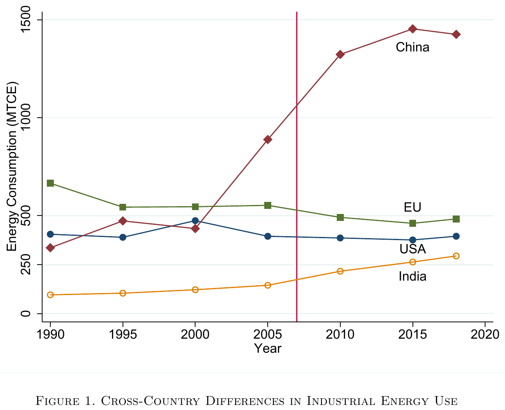

结果解读：1990—2018年间，中国工业能耗增长了三倍以上，2000年之后斜率明显变陡；同期美国与欧盟基本持平。这条曲线是“千家企业节能行动”出台的背景。

**为什么选2004年？**

这是 **政策筛选的明确要求**：

- 政策2006年启动，需要政策实施前的基准数据。
- 2004年是当时最近一个完整、已汇总发布的年度数据。
- 用政策前数据保证筛选过程科学、公正、可复核。

### 2.2 关键制度事实：从“强度控制”到“总量控制”

这是全文最重要的制度页，也是所有计量设计和模型设定的出发点。

**政策设计（文件上）** ：

- 初衷是“自愿协议”，企业承诺节能目标。
- 政府考核的是 **能效**（单位产品能耗）。

**执行现实（实际上）** ：

- 产品种类多、工艺复杂，**能效难以核验**。
- 官方给出 **5套节能量计算公式**，企业可以择优、还可以逐年更换。
- 地方政府转而给每家企业一个 **能耗消费总量配额**。
- 依托实时能耗监测系统，超额即 **限电、停产**，并与官员考核挂钩。

> 名义上是“强度控制”（提高能效），实际执行是“**总量控制**”（能耗配额）。

**这是全国性政策，地方政府负责执行。** 中央要求强度控制，但地方政府因为能效难监测，自行采取了总量配额的办法。这是地方政府的执行变通。

**为什么这个制度事实重要？**

因为它决定了两件事：

1. **模型里的约束是能耗总量上限**，不是能效指标。模型写成：$e_1 \leq \xi e_1^*$。
2. **总量控制是“转移生产”机制的根源**。如果是能效考核，核心企业提高能效就可以继续生产，不需要转移。但如果是总量配额，配额用完了，想多生产就只有一条路——**挪到别的地方去生产**。溢出就是这么来的。

**总量控制 vs 强度控制：核心区别**

| 维度 | 强度控制 | 总量控制 |
|---|---|---|
| 控制对象 | 单位GDP能耗 | 能源消费绝对量 |
| 逻辑 | 允许增长，只要能耗增速低于经济增速 | 不管GDP长多少，能耗不能超上限 |
| 优点 | 不直接限制增长 | 易监测、易执行 |
| 缺点 | 难监测能效 | 可能限制增长、有溢出 |
| 中国实践 | “十一五”核心目标 | “十二五”起明确，“十三五”形成“能耗双控” |

### 2.3 监管范围与行业能耗份额

**不在监管名单里的企业，配额不受限制吗**

**对。** Top 1,000名单里的企业有能耗配额，超过就限电停产。不在名单里的企业（包括集团内的关联企业和市场上的独立无关企业）**没有配额限制**，可以自由增加生产。这正是溢出产生的根源。

**关键数字：56%和86%**

这是理解整篇论文识别策略的核心数字：

- **被监管企业占行业能耗的56%**：Top 1,000企业在九个高耗能行业中，消耗了约56%的能源。
- **加上关联企业后升至86%**：如果把Top 1,000企业同集团的关联企业也算进来，能耗份额升至86%。

**为什么这个数字重要？**

1. **56%说明政策覆盖面广**：被监管企业本身就是行业能耗的大头，政策确实抓住了主要矛盾。
2. **86%说明集团层面更重要**：加上关联企业后，几乎覆盖了整个行业能耗的绝大部分。这意味着，如果只监管单个企业，集团可以通过关联企业规避；但如果监管整个集团，覆盖面会从56%升到86%。
3. **这是后面“监管集团可多节能10%”的基础**：正因为关联企业占了30个百分点的能耗份额，把它们纳入监管才能堵住套利空间。

**这个数字从哪来？** 从CESD和ASIF数据中直接计算：Top 1,000企业的能耗除以行业总能耗，得到56%；再加上通过CARD识别的同集团关联企业能耗，得到86%。

## 三、数据：企业—集团—行业三层结构

### 3.1 四套数据与样本限制

| 数据 | 提供什么 | 在研究里解决什么问题 |
|---|---|---|
| **CESD** 环境统计 | 企业产值与一次能源消费，2001–2010 | 能耗、产出、能效是否变化 |
| **ASIF** 工业企业调查 | 产值、行业、所有制等（规模以上） | 关联企业与市场竞争者如何反应 |
| **CARD** 工商注册 | 股东与企业关联关系 | 识别谁属于同一个所有权网络 |
| **ATS** 税收调查 | 补充产值与能源信息 | 交叉核对与稳健性检验 |

**样本限制**

CESD只记录 **一次能源**（煤、油、气），**不记录电力**。因此：

- 剔除电力占总能耗 **30%以上** 的行业。
- 要求企业有 **完整的逐年煤炭数据**。
- 最终样本：**427家** 千家企业，平均观测 **8年**。

### 3.2 识别企业集团与四位行业

用CARD数据，通过四种股权关系识别“关联企业”：

- 全资子公司
- 部分控股的公司
- 股东
- 股东的其它投资公司

**关联企业 = 通过股权关系网络与Top 1,000企业相连的企业**，同时要求关联企业必须与被监管企业处于 **同一4位行业**（生产同类产品），因为只有同类产品才可能转移生产。

同一4位行业中共有 **2,466家** 关联企业，平均每家Top 1,000企业有 **2.45家**。

**什么是“四位行业”？**

国民经济行业分类（GB/T 4754）的四级结构：

| 层级 | 代码 | 例子（钢铁） |
|---|---|---|
| 门类 | 1位字母 | `C` 制造业 |
| **大类** | **2位数字** | `31` 黑色金属冶炼和压延加工业 |
| 中类 | 3位数字 | `311` 炼铁／`312` 炼钢 |
| **小类** | **4位数字** ← **“四位行业”** | `3110` 炼铁／`3120` 炼钢 |

只有同一小类的关联企业，产品才高度可替代，才 **有能力** 承接被监管企业的产出。

### 3.3 三类企业

| 三类企业 | 是什么 | 跟谁比 |
|---|---|---|
| **A 被监管企业** | Top 1,000，政策直接针对的对象 | Top 10,000中 **无集团关联** 的企业 |
| **B 关联企业** | 与Top 1,000 **有股权关联**、且 **同处一个4位行业** | 同4位行业、规模相近的 **无关企业** |
| **C 无关企业** | 与 **任何** Top 1,000都 **无股权关联** | **无二分分组**：按自身 **2位行业** 的暴露度 |

“关联”和“无关”都相对于Top 1,000而言，判据是 **股权**。另外，A的控制组也要求“无关”：剔除与Top 1,000同属一个集团的企业。

### 3.4 三个被解释变量

| 被解释变量 | 怎么衡量 | ①被监管企业 | ②关联企业 | ③市场溢出 |
|---|---|---|---|---|
| **能耗** | CESD一次能源消费（煤、油、气，tce），不含电力 | ✔ | ✔ | — |
| **产出** | ASIF工业总产值（人民币） | ✔ | ✔ | ✔ |
| **能效** | 总销售额 ÷ 煤炭使用量 | ✔ | ✔ | — |

③只做产出——它要回答“没被管的企业有没有趁机扩张”，产出就够了。另外能效的分子是销售额、分母是煤不含电，论文因此把能效效应称为“**上界**”。

### 3.5 集团结构的基本事实

在进入DID之前，先看两个描述性事实，它们刻画了集团的基本结构：

**Figure 2 Panel A：集团内相对规模迅速下降**

- 比较对象：同一个集团内部的成员。排第 1 的是这个集团的核心企业，也就是被监管企业；第 2、3、4…… 名是同一集团内、与它同处一个 4 位行业的关联企业。
- 横轴：集团内企业按规模排名（1=最大，2=第二，3=第三……）
- 纵轴：相对规模（每家企业的规模÷最大企业的规模）
- 事实：第2家企业规模约为最大企业的 **29%**，第3家约 **20%**，第4家约 **15%**，依次迅速递减。
- **含义**：集团内“一家独大”，关联企业规模远小于核心企业。

**Figure 2 Panel B：核心企业越大，集团内关联企业越多**

- 横轴：集团内最大企业（即被监管的核心企业）的对数产出
- 纵轴：集团内关联企业数量
- 事实：正相关——核心企业越大，关联企业越多。
- **含义**：生产率高的集团，更有能力“养”更多关联企业。这为后面命题2提供了实证基础。

**这两个事实为什么重要？**

1. **Panel A说明关联企业规模小**：平均只有核心企业的29%，所以它们 **无法完全承接** 核心企业的产出下降。这就是为什么论文后面要计算“集团能把40%的产出下降转移出去”，而不是100%。
2. **Panel B说明集团规模异质性**：不同集团关联企业数量不同，所以政策对不同集团的影响也不同。模型里的 $n$（关联企业数量）就是从这个事实来的。

```stata
* 图2-A：把各集团的产出矩摊平到"第几名"，看相对规模怎么衰减
use "data_moments.dta", clear
keep if type == "Baseline"
reshape long delta_mean, i(id) j(rank)
twoway (scatter delta_mean rank if rank <= 5, msize(large)), ///
    ylabel(0(0.2)1, nogrid) xlabel(1(1)5) ///
    ytitle("Relative Size") xtitle("Rank")

* 图2-B：先数出每个集团有几家企业，再对核心企业产出做分箱散点
egen groupid = group(conglomerate ind4 year)
bysort groupid: egen number = count(firmid)
gsort groupid -loutput
by groupid: gen rank = _n          // 第1名即核心企业
keep if rank == 1
binscatter number loutput, absorb(ind4) nq(30)
```

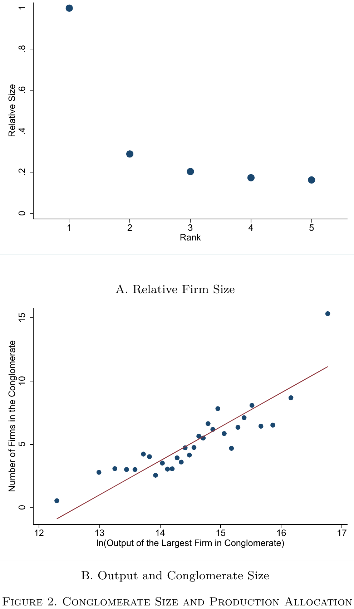

结果解读：左图里集团内相对规模随排名迅速衰减，第二家约为最大企业的29%，第三家约20%；右图里核心企业产出越大，集团内关联企业越多。这两个事实分别对应模型中的衰减参数与集团规模。

## 四、识别策略与四层DID结果

### 4.1 DID的基本逻辑

DID的核心是 **反事实**：

> 如果没有政策，被监管企业会怎样？

找一个 **控制组**——和受监管企业相似、但不受政策影响的企业——用它的变化来 **代替** 反事实。

DID估计量：

$$
\hat{\beta} = \underbrace{(\bar{Y}_{处理,后} - \bar{Y}_{处理,前})}_{\text{处理组变化}} - \underbrace{(\bar{Y}_{控制,后} - \bar{Y}_{控制,前})}_{\text{控制组变化}}
$$

**关键假设（平行趋势）** ：如果没有政策，处理组和控制组的趋势应该相似。

### 4.2 第一层DID：被监管企业自身的变化

#### 处理组和控制组

| | 处理组 | 控制组 |
|---|---|---|
| 是谁 | Top 1,000企业 | Top 10,000企业（不含Top 1,000及其关联企业） |
| 是否被监管 | 是（2006年起） | 否（2011年后才被Top 10,000监管） |
| 为什么选它 | 受政策冲击 | 与处理组相似，但政策前未受冲击 |

**为什么选Top 10,000做控制组？** 两者都是大型工业企业，政策前有相似趋势。控制组也要求“无关”：剔除与Top 1,000同属一个集团的企业，否则控制组会被集团内部转移污染。

#### 事件研究（验证平行趋势）

$$
Y_{ijkt} = \sum_{\tau \neq 2006}^{2010} \beta_\tau \times Treat_i \times Year_\tau + \alpha_i + \eta_{jt} + \delta_{kt} + \epsilon_{ijkt}
$$

- $Treat_i$：是否属于Top 1,000。
- $Year_\tau$：年份虚拟变量，以 **2006年为基准年**（系数设为0）。
- $\beta_\tau$：政策前后每一年的处理效应。
- $\alpha_i$：企业固定效应。
- $\eta_{jt}$：行业×年份固定效应。
- $\delta_{kt}$：省份×年份固定效应。

**读图逻辑**：

- 竖线左边（2001–2005）：如果平行趋势成立，$\beta_\tau$应该在零附近且不显著。
- 竖线右边（2007–2010）：如果政策有效，$\beta_\tau$应该显著偏离零。

**注意**：政策2006年4月公布，但执行从2007年开始。所以“政策后”是2007年及以后，2006年是基准年。**$Post_t = 1$ 表示2007年及以后**。

```stata
* 把 treat 与每一年的虚拟变量交互，逐年系数就是事件研究
tab year, gen(ydummy)
forvalues i = 1(1)10 {
    local j = 2000 + `i'
    gen treat_year`j' = ydummy`i' * top1000
}
* 以2006年为基准年，省略它；交互项只留2001-2005与2007-2010
reghdfe lenergy treat_year2001-treat_year2005 treat_year2007-treat_year2010, ///
    absorb(firmid ind2_year province_year) cluster(firmid)
```

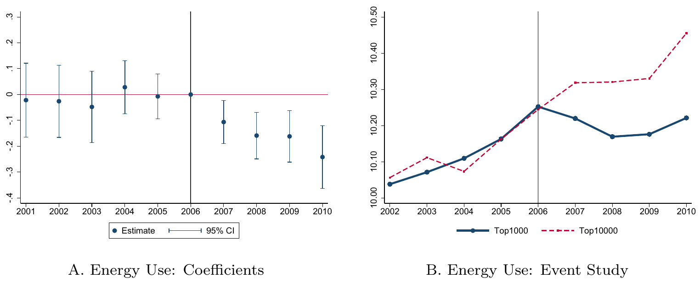

结果解读：竖线左侧的系数在零附近且不显著，说明政策前处理组与控制组趋势相近；竖线右侧系数逐年走低，政策实施后能耗持续下降。

#### 平均处理效应

$$
Y_{ijkt} = \beta \times Treat_i \times Post_t + X_{it}'\gamma + \alpha_i + \eta_{jt} + \delta_{kt} + \epsilon_{ijkt}
$$

- $Post_t$：2007年及以后=1，否则=0。
- $\beta$：政策的平均处理效应。
- $X_{it}$：企业层面控制变量（是否国企、是否出口、ROA、企业年龄等）。

标准误在 **企业层面聚类**，因为同一企业不同年份的误差可能相关。

#### 结果

| 指标 | 变化 |
|---|---|
| 能源消耗 | 下降约13%–16% |
| 产出 | 下降约10%–23% |
| **能源效率** | **没有显著提升** |

**这里的“效率”是能源效率（产出÷能源消费）** 。

**能耗和产出同步下降，能效没变**——这是“减产”，不是“提效”。

政策初衷确实是改进技术、提高能效，但事与愿违。

```stata
* 三个被解释变量各跑四列，固定效应逐层加厚
local control "soe roa age exp"
foreach y of varlist lenergy loutput lefficiency {
    eststo `y'_1: reghdfe `y' treat_post, absorb(firmid year) cluster(firmid)
    eststo `y'_2: reghdfe `y' treat_post, absorb(firmid ind2_year) cluster(firmid)
    eststo `y'_3: reghdfe `y' treat_post, ///
        absorb(firmid ind2_year province_year) cluster(firmid)
    eststo `y'_4: reghdfe `y' treat_post `control', ///
        absorb(firmid ind2_year province_year) cluster(firmid)
}
```

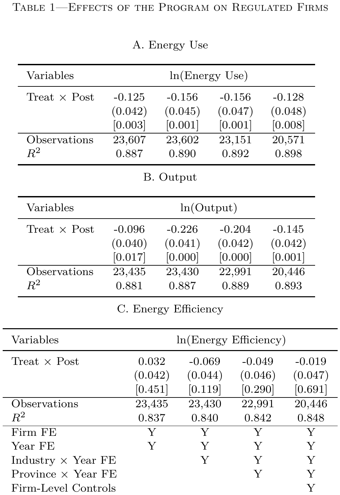

结果解读：能耗与产出两栏系数显著为负，能效一栏在逐步加入固定效应与控制变量后始终不显著。政策带来的是减产，不是提效。

### 4.3 第二层DID：集团内部的生产转移

#### 处理组和控制组

| | 处理组 | 控制组 |
|---|---|---|
| 是谁 | 关联企业（与Top 1,000有股权关联、同处一个4位行业） | 同4位行业、政策前规模相近的无关企业 |
| 匹配方式 | — | 基于产出的欧氏距离一对一匹配 |

**匹配的候选池**：在同一4位行业内，所有满足以下条件的无关企业：

1. 不属于Top 1,000
2. 与任何Top 1,000企业没有股权关联
3. 在政策前（2006年之前）已经存在

**匹配方法**：对每一家关联企业，从候选池中找出一家 **产出规模最接近** 的无关企业，配对成“一对一匹配”。欧氏距离：$d(i,j) = |Y_i - Y_j|$，找出使距离最小的那家。

**剔除最差5%**：如果某家关联企业找不到足够接近的无关企业，这对配对就被丢弃。

**为什么控制组要同4位行业？** 因为只有生产 **同类产品** 的企业，才 **有能力** 承接被监管企业的产出。不同行业的企业，就算有股权关系也搬不过去。

#### 回归方程

$$
Y_{ijkt} = \beta \times Related_i \times Post_t + X_{it}'\gamma + \alpha_i + \eta_{jt} + \delta_{kt} + \epsilon_{ijkt}
$$

标准误在 **企业层面聚类**。

#### 结果

| 指标 | 变化 |
|---|---|
| 产出 | 上升约11.8%–15.2% |
| 能耗 | 上升约30.2%–32.2% |
| 能效 | 没有显著改善 |

```stata
* 候选池：同一4位行业、不属于Top 1,000、且与之无股权关系的企业
* 配对规则：按产出规模的欧氏距离找最近的一家，最差5%的配对丢弃
* 回归带上匹配权重
reghdfe loutput related_post [fweight = weight], ///
    absorb(firmid ind2_year province_year) cluster(firmid)
```

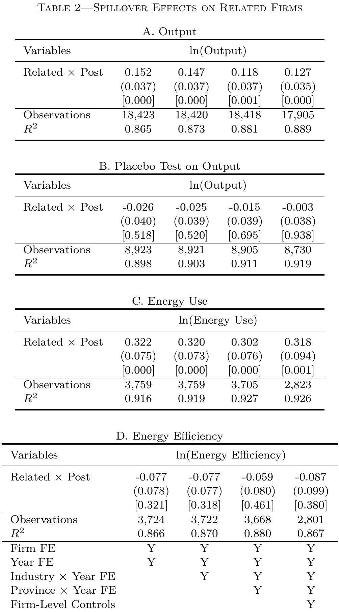

结果解读：关联企业产出显著上升，能耗上升幅度更大，能效不显著。同一张表里的安慰剂组系数接近零且不显著。

**被监管企业减产，同行业的关联企业增产**——生产在集团内部被重新配置了。

**集团内部转移 = 自己人帮自己人。** 母公司（Top 1,000）被限产，把生产任务转给同一集团内的子公司。

#### 为什么突然提出“40%”这个概念？

论文到这里已经立起两个事实：被监管企业产出下降 **14.5%**（Table 1 Panel B），同行业的关联企业产出上升 **12.7%**（Table 2 Panel A）。两个数字放在一起，立刻逼出一个新问题：

> **被监管企业减掉的那些生产，到底有多少被关联企业接走了？**

答案决定政策该怎么读。如果关联企业能把减掉的产出 **全部** 接走，政策就只是“换个地方生产”，总量没变；如果只能接走 **一部分**，剩下的部分必然流到市场上，被独立企业接走。

**40% 就是这个问题的答案，也是连接“集团内部转移”与“市场溢出”的桥梁。**

| 被监管企业产出下降的去向 | 占比 |
|---|---|
| 集团内部转移（关联企业承接） | 约 40% |
| 市场溢出（独立企业承接） | 约 60% |

没有这个计算，读者会问：既然集团可以把生产转给关联企业，市场上为什么还会有溢出？答案是关联企业的承接能力有限，只能接走四成，剩下的六成必须由市场上的独立企业承接。

**为什么承接能力有限？** 两个约束叠在一起。关联企业 **数量** 有限，平均每家 Top 1,000 企业只有 **2.45家** 关联企业；关联企业 **规模** 有限，平均只有被监管企业的 **19.3%**（关联企业平均产出 ÷ 被监管企业产出，用 ASIF 2004 年数据计算）。两者相乘得到约 47%，这是集团内部转移的 **物理上限**。

计算分三步。

**第一步：先算关联企业总规模。**

$$
2.45 \times 19.3\% \approx 47\%
$$

所有关联企业加在一起，相当于被监管企业原产出的 47%。

**第二步：再算关联企业增产的部分。** 政策后关联企业产出增加 **12.7%**（来自 Table 2 Panel A 第 (4) 列的 DID 回归，衡量关联企业相对于同行业无关企业的产出上升），这 12.7% 是相对于它们自己原有产出的增量。

$$
47\% \times 12.7\% \approx 6\%
$$

关联企业新增的产出，相当于被监管企业原产出的 6%。

**第三步：对比被监管企业的减产幅度。** 被监管企业产出下降 **14.5%**（来自 Table 1 Panel B 第 (4) 列的 DID 回归，衡量被监管企业相对于 Top 10,000 的产出下降），所以关联企业承接了其中：

$$
\frac{6\%}{14.5\%} \approx 41\%
$$

**这个计算在论文 Section III 的末尾，紧接 Table 2 之后。** 先报告关联企业增产 12.7%，再把“关联企业增产”翻译成“被监管企业的减产有多少被接走了”。这是从 **局部 DID 估计** 到 **全局量化** 的关键一跳：没有这一步，读者只知道关联企业增产了，不知道这件事有多重要。

实际转移的 40% 很接近 47% 这个上限，说明集团已经尽力了。**集团内部转移是有限的**，这也解释了为什么市场层面还会有溢出——剩下的需求只能由市场上的独立企业来满足。

#### 安慰剂检验

**做法**：找那些与受监管企业 **同2位行业、但不同4位行业** 的关联企业。它们同样有股权关系，但 **生产不了同类产品**，所以 **不应该** 承接生产。

**结果**：系数为−0.026 ~ −0.003，p值0.518 ~ 0.938，**完全不显著**。

**结论**：只有能生产 **同类产品** 的关联企业，才会承接生产。结果不是“集团企业本身的行为差异”。同时排除了金融危机、出口冲击等同期冲击的解释。

```stata
* 安慰剂：同2位行业、不同4位行业的关联企业
* 有股权关系，但产品不可替代，理论上接不了生产
* 配对池、距离匹配、加权回归的流程与主回归完全一致
reghdfe loutput related_post [fweight = weight], ///
    absorb(firmid ind2_year province_year) cluster(firmid)
```

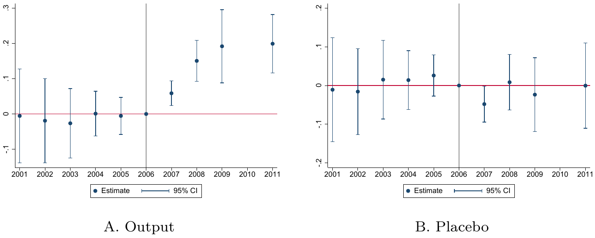

结果解读：左图里关联企业产出在2006年后持续上升；右图是安慰剂组的同一图形，政策前后都围绕零波动。

### 4.4 第三层DID：集团内部再验证

#### 设计

加入 **集团×年份固定效应**：

$$
Y_{ijkt} = \beta \times Treat_i \times Post_t + \alpha_i + \gamma_{g \times t} + \epsilon_{ijkt}
$$

- $\gamma_{g \times t}$：集团×年份固定效应。
- 这个固定效应吸收了 **同一集团在同一年** 里所有的共同冲击（融资、治理、需求）。
- 识别完全来自 **同一集团内部**：被监管的那家 vs 没被监管的那家。

#### 结果

同一集团内，被监管企业相对关联企业的产出 **持续下降31.5%–36.7%**。

#### 意义

这是对“转移生产”最干净、最直接的证据。因为所有集团层面的共同冲击都被吸收了，剩下的差异只能来自政策对核心企业的约束。

```stata
* 集团×年份固定效应吸收了集团层面的共同冲击
* 识别只来自"同一集团、同一年"里被监管那家 vs 没被监管那家
reghdfe loutput treat_post top1000, ///
    absorb(conglomerate_year ind2_year province_year) cluster(conglomerate)
```

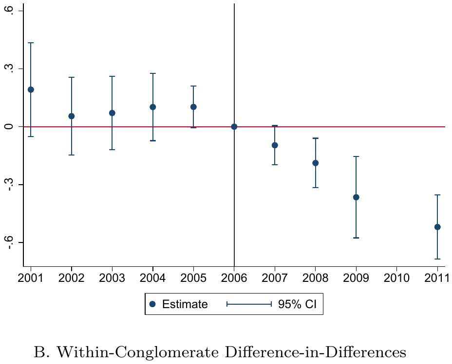

结果解读：竖线左侧系数在零附近，右侧系数逐年走低，被监管企业相对同一集团内关联企业的产出持续下降。

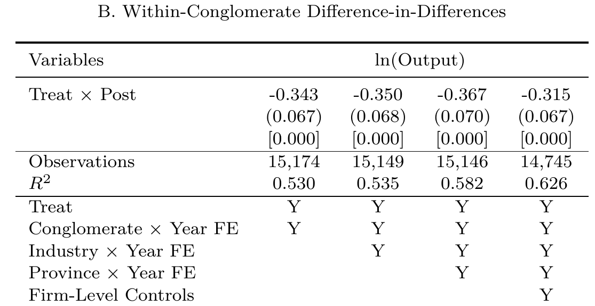

结果解读：同一集团内被监管企业相对关联企业的产出持续下降，加入集团×年份固定效应后系数依然显著为负。

### 4.5 第四层DID：市场溢出（连续型）

#### 设计

这一层和前两层不同，**没有处理组和控制组的二分**，用的是 **连续的行业暴露度**：

$$
\text{Spillover}_j = \frac{\text{该2位行业中Top 1,000企业的节能目标总量}}{\text{该2位行业2004年总能耗}}
$$

这个变量衡量每个行业受到的 **监管冲击强度**。钢铁行业可能很高（被监管企业多、节能目标大），纺织行业可能很低。

#### 回归方程

$$
Y_{ijkt} = \beta \times Spillover_j \times Post_t + X_{it}'\gamma + \alpha_i + \eta_t + \epsilon_{ijkt}
$$

- $Spillover_j$：行业层面的监管暴露度。
- $Post_t$：2007年及以后=1。
- $\alpha_i$：企业固定效应。
- $\eta_t$：年份固定效应。
- **注意**：这里不放行业×年份固定效应，因为处理变量是行业层面的。

#### $Spillover_j$ 单独会被吸收

- $Spillover_j$ 对每个行业是常数，会被行业固定效应吸收。
- 但$Spillover_j \times Post_t$在政策前后有变化、在不同行业之间有差异，这才是识别力的来源。

#### 识别逻辑

> 比较 **暴露度高的行业** 和 **暴露度低的行业**，在政策前后，无关企业的产出变化是否有系统差异。

| | 政策前 | 政策后 | 变化 |
|---|---|---|---|
| **高暴露行业** | 无关企业产出 | 无关企业产出 | 如果涨得多 → 政策有溢出 |
| **低暴露行业** | 无关企业产出 | 无关企业产出 | 如果涨得少或不变 → 对照 |

#### 标准误

标准误在 **行业层面聚类**，因为处理变量是行业层面的。同一个行业里的所有企业，$Spillover_j$ 取值相同。如果标准误在企业层面聚类，会 **低估标准误**，因为同一行业内的企业面对相同的行业冲击，误差项可能相关。这就是经典的 **Moulton问题**。

#### 结果

监管更严的行业里，未被监管、也不属于任何集团的独立企业，产出增加约 **7.3%–8.4%**。

**市场转移 = 外人趁火打劫。** 被监管企业减产→价格上升→独立企业趁机扩大生产。


```stata
* 处理变量是行业层面的连续暴露度，标准误聚类到2位行业
reghdfe loutput spillover_post loutput_ind2 lenergy_ind2 soe roa age exp ///
    if top1000_industry == 1, absorb(firmid year) cluster(ind2)
```

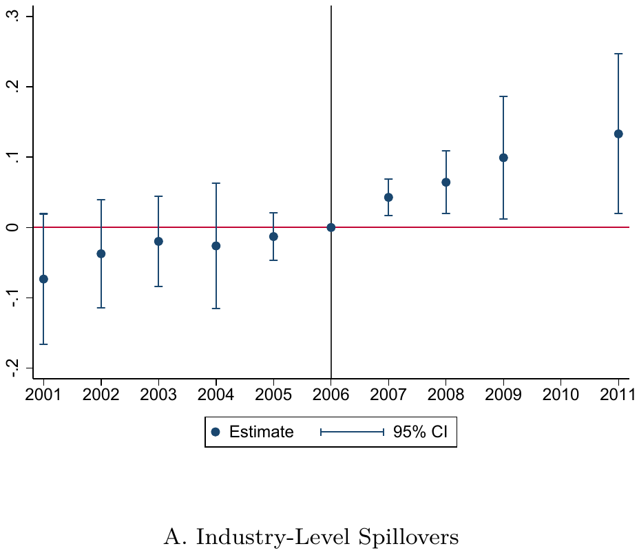

结果解读：竖线左侧系数在零附近，右侧系数转正并逐年走高，高暴露行业里的无关企业产出在政策后上升。

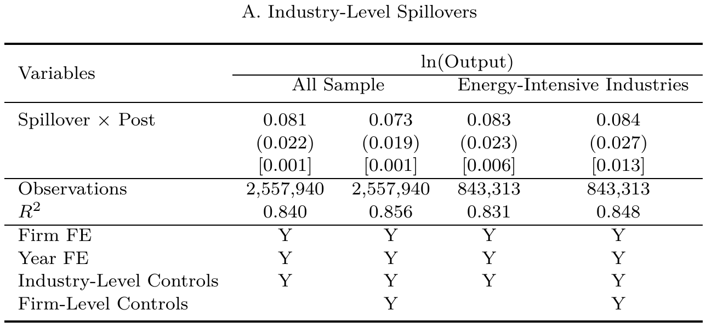

结果解读：行业暴露度与政策后的交互项显著为正。暴露度越高的行业，无关企业产出上升越多。

### 4.6 四层DID的结果（特征事实的呈现）

**发现1：被监管企业减产，但没提效**

| 指标 | 变化 |
|---|---|
| 能源消耗 | 下降约13%–16% |
| 产出 | 下降约10%–23% |
| **能源效率** | **没有显著提升** |

**这里的“效率”是能源效率（产出÷能源消费），不是生产效率（TFP）。**

- 能源效率衡量的是“用多少能源生产一件产品”。
- 生产效率（全要素生产率，TFP）是剔除所有投入要素后的剩余生产率。论文 **没有** 直接研究TFP。
- 论文中所有关于“效率”的分析，默认都是 **能源效率**。

**政策初衷确实是改进技术、提高能效**，但事与愿违：企业不是通过技术进步节能，而是 **直接减产** 来达标。

**发现2：集团内部泄漏——关联企业增产**

- 同一集团内、同一4位行业、未被监管的关联企业：
  - 产出增加约 **12%**
  - 能耗也增加
  - 能效也没提高
- 集团能把被监管企业产出下降的 **约40%** 转移到关联企业。

**为什么只有40%？** 关联企业加总起来相当于被监管企业产出的约47%，这是承接能力的上限；但它们政策后只增产 12.7%，折算下来实际承接了产出下降的约41%，剩下六成承接不了。

**集团内部转移 = 自己人帮自己人。** 母公司（Top 1,000）被限产，把生产任务转给同一集团内的子公司。

**发现3：市场泄漏——独立企业也增产**

- 监管更严的行业里，未被监管、也不属于任何集团的独立企业：
  - 产出增加约 **7%–8%**
- 它们趁机抢占被监管企业让出的市场份额。

**市场转移 = 外人趁火打劫。** 被监管企业减产→价格上升→独立企业趁机扩大生产。

**发现4：总体效果大打折扣**

- 被监管企业能耗下降很多；
- 但考虑集团内部和市场泄漏后，**全国总能耗只下降了约4%**；
- 相当于每年节能约 **4800万吨标准煤**，而不是政策预期的1亿吨。

**强度转总量对论文研究的影响**

这个转变对论文的研究设计有 **决定性影响**：

1. **模型设定**：论文的模型假设政策是 **对核心企业的能耗总量施加约束**（$e_1 \leq \xi e_1^*$），而不是对能效施加约束。
2. **识别策略**：DID识别的是“被监管企业 vs 未被监管企业”的能耗差异。如果政策是强度控制，结果变量应该是能效；但因为是总量控制，结果变量是能耗总量。
3. **机制分析**：集团内部转移的逻辑是“核心企业能耗配额不够→把生产转移到关联企业”。这只有在 **总量控制** 下才成立。如果是强度控制，核心企业只要提高能效就可以继续生产，不需要转移。
4. **政策建议**：论文建议“监管整个集团”而不是单个企业，这也是针对 **总量控制** 的设计。

论文在附录A中明确说明：**我们的模型和政策分析基于实际执行的总量控制，而不是文件上写的强度控制。**

### 4.7 四层DID总结与局限

| 层级 | 处理组 | 控制组 | 核心问题 | 结果 |
|---|---|---|---|---|
| 第一层 | Top 1,000 | Top 10,000（无集团关联） | 被监管企业自身变了吗？ | 能耗降13%–16%，产出降10%–23%，能效没变 |
| 第二层 | 关联企业（同4位行业） | 同4位行业、规模相近的无关企业 | 生产转移到集团内部了吗？ | 关联企业产出涨11.8%–15.2%，只能转移约40% |
| 第三层 | 同一集团内被监管企业 | 同一集团内关联企业 | 转移是否发生在集团内部？ | 被监管企业相对关联企业降31.5%–36.7% |
| 第四层 | 高暴露行业的无关企业 | 低暴露行业的无关企业 | 市场层面有溢出吗？ | 无关企业产出涨7.3%–8.4% |

**DID的局限**

DID只能识别 **净效应**，但不能：

1. 区分集团内部转移和市场转移 **各占多少**。
2. 计算 **全国净节能** 是多少。
3. 模拟 **替代政策**（如监管集团、能源税）的效果。
4. 计算 **福利成本**。

所以论文又建了 **结构模型** 来补充。

## 五、结构模型与参数估计

### 5.1 为什么要建模型？

DID只能告诉我们“发生了什么”，但不能量化：集团内部转移了多少？市场溢出有多大？换一种政策设计，效果会怎样？所以作者建了一个 **行业均衡模型**。

### 5.2 Melitz模型与本文的扩展

#### Melitz模型是什么？

Melitz（2003）是国际贸易和产业组织领域的 **里程碑式论文**，全称《The Impact of Trade on Intra-Industry Reallocations and Aggregate Industry Productivity》。它首次将 **企业生产率异质性** 引入垄断竞争的一般均衡框架。

Melitz模型本质上是 **Krugman（1980）新贸易理论模型的扩展**，保留了垄断竞争的同质性企业假设，但加入了一个关键创新：**企业生产率不同**。

#### 模型的核心假设

| 假设 | 具体内容 |
|---|---|
| **消费者偏好** | CES效用函数，偏好多样化产品 |
| **市场结构** | 垄断竞争，每个企业生产一种独特产品 |
| **企业异质性** | 每个企业从分布 $G(\phi)$ 中随机抽取生产率 $\phi$ |
| **固定成本** | 企业进入市场需支付固定成本f |
| **规模报酬** | 生产函数规模报酬递减 |

#### 模型的核心机制

**需求侧**：CES偏好下，每个企业面对的需求曲线为：

$$
q(\omega) = RP^{\sigma-1}p(\omega)^{-\sigma}
$$

**生产侧**：企业以生产率 $\phi$ 进行生产，边际成本与 $\phi$ 成反比。

**关键机制**：

- 企业进入市场前不知道自己的生产率，需要支付固定成本后才能观察到 $\phi$。
- 观察到 $\phi$ 后，企业决定是否继续生产。
- **生产率低于某个阈值 $\phi^*$ 的企业会退出市场**（因为利润为负）。
- **生产率高于 $\phi^*$ 的企业留在市场**，且生产率越高，企业规模越大、利润越高。

**零利润条件（ZCP）** ：边际企业的利润恰好为零。

**自由进入条件（FE）** ：企业进入市场的期望利润等于进入成本。

**均衡结果**：生产率阈值 $\phi^*$ 和市场中的企业数量 $M$ 同时被确定。只有生产率足够高的企业才能生存。

#### Melitz模型的核心结论

1. **企业规模分布右偏**：少数高生产率企业占据大部分市场份额。
2. **优胜劣汰**：低生产率企业退出市场。
3. **资源再配置**：资源从低生产率企业流向高生产率企业。

**论文的模型：Melitz + 企业集团 + 能源监管**

#### 论文做了什么扩展？

论文在Melitz模型基础上做了 **三个关键扩展**：

| 扩展 | 具体内容 |
|---|---|
| **加入企业集团** | 一个“集团”由多个关联企业组成，共享核心生产率 $\phi$ |
| **加入能源投入** | 生产需要资本、劳动和能源 |
| **加入政策冲击** | 对集团核心企业施加能耗上限 |

#### 论文模型的核心设定

**消费者偏好**（与Melitz相同）：

$$
U = \left[\int_{\omega \in \Omega} q(\omega)^\rho d\omega \right]^{1/\rho}
$$

- $q(\omega)$：产品$\omega$的消费量。
- $\rho$：替代参数，$\sigma = 1/(1-\rho)$是产品间替代弹性。

效用最大化后得到 **残差需求曲线**：

$$
q(\omega) = RP^{\sigma-1}p(\omega)^{-\sigma}
$$

**需求函数的推导过程**：

**第一步**：写出拉格朗日函数：

$$
\mathcal{L} = \left[\int_{\omega \in \Omega} q(\omega)^\rho d\omega \right]^{1/\rho} + \lambda\left[R - \int_{\omega \in \Omega} p(\omega) q(\omega) d\omega\right]
$$

**第二步**：对$q(\omega)$求一阶条件：

$$
\frac{\partial \mathcal{L}}{\partial q(\omega)} = \frac{1}{\rho}\left[\int q(\omega)^\rho d\omega\right]^{\frac{1}{\rho}-1} \cdot \rho q(\omega)^{\rho-1} - \lambda p(\omega) = 0
$$

化简：

$$
\left[\int q(\omega)^\rho d\omega\right]^{\frac{1-\rho}{\rho}} \cdot q(\omega)^{\rho-1} = \lambda p(\omega)
$$

注意$\left[\int q(\omega)^\rho d\omega\right]^{1/\rho} = U$，所以：

$$
U^{1-\rho} \cdot q(\omega)^{\rho-1} = \lambda p(\omega)
$$

**第三步**：解出$q(\omega)$：

$$
q(\omega)^{\rho-1} = \lambda p(\omega) U^{\rho-1}
$$

两边取$1/(\rho-1)$次方：

$$
q(\omega) = \left[\lambda U^{\rho-1}\right]^{\frac{1}{\rho-1}} \cdot p(\omega)^{\frac{1}{\rho-1}}
$$

注意$\frac{1}{\rho-1} = -\frac{1}{1-\rho} = -\sigma$，所以：

$$
q(\omega) = \left[\lambda U^{\rho-1}\right]^{-\sigma} \cdot p(\omega)^{-\sigma}
$$

**第四步**：用预算约束确定常数：

$$
\int p(\omega) q(\omega) d\omega = R
$$

$$
\int p(\omega) \cdot \left[\lambda U^{\rho-1}\right]^{-\sigma} \cdot p(\omega)^{-\sigma} d\omega = R
$$

$$
\left[\lambda U^{\rho-1}\right]^{-\sigma} \int p(\omega)^{1-\sigma} d\omega = R
$$

定义 **价格指数**：

$$
P = \left[\int p(\omega)^{1-\sigma} d\omega\right]^{\frac{1}{1-\sigma}}
$$

所以：

$$
\int p(\omega)^{1-\sigma} d\omega = P^{1-\sigma}
$$

代入：

$$
\left[\lambda U^{\rho-1}\right]^{-\sigma} \cdot P^{1-\sigma} = R
$$

$$
\left[\lambda U^{\rho-1}\right]^{-\sigma} = R \cdot P^{\sigma-1}
$$

**第五步**：代回得到最终需求函数：

$$
\boxed{q(\omega) = R P^{\sigma-1} p(\omega)^{-\sigma}}
$$

**小 $p$ 和大 $P$ 不一样**：

| 符号 | 含义 |
|---|---|
| **小 $p(\omega)$** | **单个产品 $\omega$ 的价格**。比如某家钢铁厂定的钢价。 |
| **大 $P$** | **价格指数**，是所有产品价格的CES加总：$P = \left[\int_{\omega \in \Omega} p(\omega)^{1-\sigma} d\omega\right]^{\frac{1}{1-\sigma}}$ |

大 $P$ 可以理解成 **整个行业的平均价格水平**。它和单个企业的定价有关，但又不是任何一家企业的价格。

**从需求函数到收入函数**：

**第一步**：从需求函数解出价格：

$$
p(\omega)^{-\sigma} = \frac{q(\omega)}{RP^{\sigma-1}}
$$

两边取$-1/\sigma$次方：

$$
p(\omega) = R^{1/\sigma}P^{\frac{\sigma-1}{\sigma}}q(\omega)^{-1/\sigma}
$$

**第二步**：计算收入：

$$
p(\omega)q(\omega) = R^{1/\sigma}P^{\frac{\sigma-1}{\sigma}}q(\omega)^{1-1/\sigma}
$$

把$\sigma = 1/(1-\rho)$代入：

- $1/\sigma = 1-\rho$
- $(\sigma-1)/\sigma = 1 - 1/\sigma = 1-(1-\rho) = \rho$
- $1-1/\sigma = 1-(1-\rho) = \rho$

所以：

$$
\boxed{p(\omega)q(\omega) = R^{1-\rho}P^\rho q(\omega)^\rho}
$$

**集团结构**：

- 一个集团由一个核心企业（Top 1,000）和若干个关联企业组成。
- 第$i$个关联企业的生产率为$\delta^{i-1}\phi$，其中$\delta<1$，表示集团内部效率递减。
- 核心企业生产率最高（$i=1$），关联企业依次递减。

**生产函数**（第$i$个企业）：

$$
q_i = \phi \delta^{i-1} k_i^{\alpha_k} l_i^{\alpha_l}
$$

- $\phi$：集团核心生产率。
- $\delta^{i-1}$：第$i$个关联企业的效率衰减。
- $k_i$：资本。
- $l_i$：劳动/可变投入（能源与劳动按Leontief技术互补，所以$l_i=e_i$）。
- $\alpha_k, \alpha_l$：资本和劳动的产出弹性。
- $\alpha = \alpha_k + \alpha_l < 1$：规模报酬递减。

**集团利润最大化（无政策时）** ：

$$
\pi(\phi, n) = \max_{\{l_i\}, \{k_i\}} \left\{ R^{1-\rho}P^\rho \left[\sum_{i=1}^n \phi \delta^{i-1} k_i^{\alpha_k} l_i^{\alpha_l}\right]^\rho - (w+p_e)\sum_{i=1}^n l_i - r\sum_{i=1}^n k_i \right\}
$$

**这个利润函数的来源**：

**第一步**：从需求函数到收入函数（如上）。

**第二步**：集团的总产出是各家企业产出之和：

$$
q(\omega) = \sum_{i=1}^n q_i = \sum_{i=1}^n \phi \delta^{i-1} k_i^{\alpha_k} l_i^{\alpha_l}
$$

**第三步**：把总产出代入收入函数：

$$
\text{收入} = R^{1-\rho}P^\rho \left[\sum_{i=1}^n \phi \delta^{i-1} k_i^{\alpha_k} l_i^{\alpha_l}\right]^\rho
$$

**第四步**：减去成本：

- 可变投入成本：$(w+p_e)\sum_{i=1}^n l_i$
- 资本成本：$r\sum_{i=1}^n k_i$

得到：

$$
\boxed{\pi(\phi, n) = R^{1-\rho}P^\rho \left[\sum_{i=1}^n \phi \delta^{i-1} k_i^{\alpha_k} l_i^{\alpha_l}\right]^\rho - (w+p_e)\sum_{i=1}^n l_i - r\sum_{i=1}^n k_i}
$$

- $w$：工资。
- $p_e$：能源价格。
- $r$：资本价格。

### 5.3 命题1与命题2的推导

**命题1：集团内部产出、投入按$\delta^{(i-1)/(1-\alpha)}$递减。**

**推导来源**：集团利润最大化问题的一阶条件。

**第一步**：写出利润函数：

$$
\pi(\phi, n) = R^{1-\rho}P^\rho \left[\sum_{i=1}^n \phi \delta^{i-1} k_i^{\alpha_k} l_i^{\alpha_l}\right]^\rho - (w+p_e)\sum_{i=1}^n l_i - r\sum_{i=1}^n k_i
$$

**第二步**：对$k_i$求一阶条件：

$$
R^{1-\rho}P^\rho \rho \left[\sum_{j=1}^n \phi \delta^{j-1} k_j^{\alpha_k} l_j^{\alpha_l}\right]^{\rho-1} \phi \delta^{i-1} \alpha_k k_i^{\alpha_k-1} l_i^{\alpha_l} = r
$$

**第三步**：对$l_i$求一阶条件：

$$
R^{1-\rho}P^\rho \rho \left[\sum_{j=1}^n \phi \delta^{j-1} k_j^{\alpha_k} l_j^{\alpha_l}\right]^{\rho-1} \phi \delta^{i-1} \alpha_l k_i^{\alpha_k} l_i^{\alpha_l-1} = w+p_e
$$

**第四步**：两式相除：

$$
\frac{\alpha_k k_i^{\alpha_k-1} l_i^{\alpha_l}}{\alpha_l k_i^{\alpha_k} l_i^{\alpha_l-1}} = \frac{r}{w+p_e}
$$

整理：

$$
\frac{\alpha_k}{\alpha_l} \cdot \frac{l_i}{k_i} = \frac{r}{w+p_e}
$$

$$
\frac{l_i}{k_i} = \frac{\alpha_l}{\alpha_k} \cdot \frac{r}{w+p_e}
$$

**第五步**：对第1家企业和第$i$家企业分别写出一阶条件，然后相除：

$$
\frac{\delta^{i-1} k_i^{\alpha_k-1} l_i^{\alpha_l}}{\delta^0 k_1^{\alpha_k-1} l_1^{\alpha_l}} = 1
$$

利用$\frac{l_i}{k_i} = \frac{l_1}{k_1}$（资本-劳动比相同），得到：

$$
\frac{k_i}{k_1} = \delta^{\frac{i-1}{1-\alpha}}
$$

同理：

$$
\frac{l_i}{l_1} = \delta^{\frac{i-1}{1-\alpha}}
$$

**第六步**：产出比：

$$
\frac{q_i}{q_1} = \frac{\phi \delta^{i-1} k_i^{\alpha_k} l_i^{\alpha_l}}{\phi k_1^{\alpha_k} l_1^{\alpha_l}} = \delta^{i-1} \left(\frac{k_i}{k_1}\right)^{\alpha_k} \left(\frac{l_i}{l_1}\right)^{\alpha_l}
$$

代入：

$$
\frac{q_i}{q_1} = \delta^{i-1} \cdot \delta^{\frac{(i-1)\alpha_k}{1-\alpha}} \cdot \delta^{\frac{(i-1)\alpha_l}{1-\alpha}} = \delta^{\frac{i-1}{1-\alpha}}
$$

**命题1得证。**

**命题2的数学推导**

**命题2：集团内关联企业数量随核心企业生产率递增。**

**推导来源**：集团比较不同规模$n$的利润。

**第一步**：定义集团利润（已优化$k_i, l_i$后）：

$$
\pi(\phi, n) = R^{\frac{1-\rho}{1-\alpha\rho}}P^{\frac{\rho}{1-\alpha\rho}}C_\pi (\phi \Delta_n)^{\frac{\rho}{1-\alpha\rho}} - nfr
$$

其中：

$$
\Delta_n = \left[\sum_{i=1}^n (\delta^{i-1})^{\frac{1}{1-\alpha}}\right]^{1-\alpha}
$$

- $f$：每增加一家关联企业的固定资本支出
- $r$：资本价格
- $fr$：每增加一家关联企业的固定成本

**第二步**：集团增加第$n+1$家关联企业的条件：

$$
\pi(\phi, n+1) - \pi(\phi, n) - fr > 0
$$

**第三步**：代入利润函数：

$$
R^{\frac{1-\rho}{1-\alpha\rho}}P^{\frac{\rho}{1-\alpha\rho}}C_\pi \left[(\phi \Delta_{n+1})^{\frac{\rho}{1-\alpha\rho}} - (\phi \Delta_n)^{\frac{\rho}{1-\alpha\rho}}\right] - fr > 0
$$

**第四步**：找到无差异点。在阈值$\phi_{n+1}$上，增加和不增加无差异：

$$
R^{\frac{1-\rho}{1-\alpha\rho}}P^{\frac{\rho}{1-\alpha\rho}}C_\pi \left[(\phi_{n+1} \Delta_{n+1})^{\frac{\rho}{1-\alpha\rho}} - (\phi_{n+1} \Delta_n)^{\frac{\rho}{1-\alpha\rho}}\right] = fr
$$

**第五步**：提取公因式$\phi_{n+1}^{\frac{\rho}{1-\alpha\rho}}$：

$$
R^{\frac{1-\rho}{1-\alpha\rho}}P^{\frac{\rho}{1-\alpha\rho}}C_\pi \cdot \phi_{n+1}^{\frac{\rho}{1-\alpha\rho}} \left[\Delta_{n+1}^{\frac{\rho}{1-\alpha\rho}} - \Delta_n^{\frac{\rho}{1-\alpha\rho}}\right] = fr
$$

**第六步**：解出$\phi_{n+1}$：

$$
\phi_{n+1}^{\frac{\rho}{1-\alpha\rho}} = \frac{fr}{R^{\frac{1-\rho}{1-\alpha\rho}}P^{\frac{\rho}{1-\alpha\rho}}C_\pi \left[\Delta_{n+1}^{\frac{\rho}{1-\alpha\rho}} - \Delta_n^{\frac{\rho}{1-\alpha\rho}}\right]}
$$

两边取$\frac{1-\alpha\rho}{\rho}$次方：

$$
\boxed{\phi_{n+1} = \frac{(fr)^{\frac{1-\alpha\rho}{\rho}}}{R^{\frac{1-\rho}{\rho}} \cdot P \cdot C_\pi^{\frac{1-\alpha\rho}{\rho}} \cdot \left[\Delta_{n+1}^{\frac{\rho}{1-\alpha\rho}} - \Delta_n^{\frac{\rho}{1-\alpha\rho}}\right]^{\frac{1-\alpha\rho}{\rho}}}}
$$

**命题2得证**：生产率高于$\phi_n$的集团选择至少$n$家关联企业。

**为什么“生产率高于$\phi_n$的集团选择至少$n$家”？**

因为利润增量关于$\phi$是 **严格递增** 的。$\phi$越大，利润增量越大。在$\phi = \phi_n$时，利润增量恰好等于固定成本$fr$。所以：

- 如果$\phi > \phi_n$，利润增量 > $fr$，增加第$n$家划算。
- 如果$\phi < \phi_n$，利润增量 < $fr$，增加第$n$家不划算。

**r在命题2里的角色**：

- $f$是每增加一家关联企业的固定资本支出。
- $r$是资本价格。
- 两者相乘$fr$就是 **固定成本**。
- 如果利润增量大于$fr$，集团就增加这家关联企业。

**命题2解释了Figure 2 Panel B的什么？**

Figure 2 Panel B展示的是：**核心企业越大，集团内关联企业越多。**

- **横轴**：最大企业的对数产出（$\ln(\text{Output of the Largest Firm})$）。
- **纵轴**：集团内关联企业数量（Number of Firms in the Conglomerate）。
- **图形**：正相关——核心企业越大，关联企业越多。

**命题2的预测**：

$$
\text{核心企业生产率}\phi \uparrow \Rightarrow \text{关联企业数量}n \uparrow
$$

这与Figure 2 Panel B的实证事实 **一致**。说明命题2不是空中楼阁，而是和真实数据对得上的。

**为什么核心企业越大，关联企业越多？**

直觉：生产率高的集团，多开一家关联企业的边际收益更大。因为核心企业效率高，整个集团的边际成本曲线更低，多一家企业带来的额外利润更大。而固定成本$fr$是固定的，所以生产率高的集团更愿意多开企业。

### 5.4 政策冲击、集团最优反应与命题3

政策对核心企业施加能耗上限：

$$
e_1 \leq \xi e_1^*
$$

- $\xi < 1$：能耗削减比例。
- $e_1^*$：无政策时核心企业的能耗。

**集团最优反应（有政策时）**

拉格朗日函数：

$$
\mathcal{L} = R^{1-\rho}P^\rho \left[\phi^*\sum_{i=1}^n \delta^{\frac{(i-1)(1-\alpha_l)}{1-\alpha}} l_i^{\alpha_l}\right]^\rho - (w+p_e)\sum_{i=1}^n l_i - r\sum_{i=1}^n k_i^* + \lambda(\xi l_1^* - l_1)
$$

**为什么从$e$变成了$l$？**

因为模型假设能源与劳动按Leontief技术互补，所以$e_i = l_i$。

- Leontief技术：$\bar{l}_i = \min\{l_i, e_i \nu_i\}$，在基准模型里$\nu_i = 1$，所以$\bar{l}_i = \min\{l_i, e_i\}$。
- 最优时，企业不会让其中一种投入多余，所以$l_i = e_i$。
- 政策约束原本是$e_1 \leq \xi e_1^*$，但因为$e_1 = l_1$，所以等价于$l_1 \leq \xi l_1^*$。
- 拉格朗日乘子项写成$\lambda(\xi l_1^* - l_1)$，这不是“从e变成了l”，而是因为$e = l$，两种写法等价。
- 写成$l$是因为模型里**决策变量是$l_i$**，不是$e_i$。集团选择劳动投入$l_i$，能源投入自动等于$l_i$。所以约束写成$l_1$，和决策变量一致，方便求一阶条件。

- $\lambda$：影子成本，即能耗约束的边际价值。

**一阶条件**：

$$
\frac{\partial \pi}{\partial l_i} = \underbrace{R^{1-\rho}P^\rho}_{\text{市场需求}} \cdot \rho \underbrace{\left[\phi^*\sum_{i=1}^n \delta^{\frac{(i-1)(1-\alpha_l)}{1-\alpha}} l_i^{\alpha_l}\right]^{\rho-1}}_{\text{残差收入}} \cdot \underbrace{\phi^* \delta^{\frac{(i-1)(1-\alpha_l)}{1-\alpha}} \alpha_l l_i^{\alpha_l-1}}_{\text{边际产出}} = w + p_e + \underbrace{\lambda \cdot \mathbb{I}[i=1]}_{\text{影子成本}}
$$

**关键含义**：只有核心企业（$i=1$）的成本里多出一项$\lambda$。这就是监管造成的 **楔子**。

**命题3的数学推导**

**命题3：政策后，集团内投入分配变为$l_i/l_1 = \delta^{(i-1)/(1-\alpha)}[1+\lambda/(w+p_e)]^{1/(1-\alpha)}$。**

**推导来源**：有政策约束的一阶条件。

**第一步**：核心企业（$i=1$）的一阶条件：

$$
\text{FOC}_1 = w + p_e + \lambda
$$

**第二步**：关联企业（$i>1$）的一阶条件：

$$
\text{FOC}_i = w + p_e
$$

**第三步**：两式相除：

$$
\frac{\delta^{(i-1)(1-\alpha_l)/(1-\alpha)} l_i^{\alpha_l-1}}{\delta^0 l_1^{\alpha_l-1}} = \frac{w+p_e}{w+p_e+\lambda}
$$

**第四步**：整理：

$$
\frac{l_i^{\alpha_l-1}}{l_1^{\alpha_l-1}} = \delta^{-\frac{(i-1)(1-\alpha_l)}{1-\alpha}} \cdot \frac{w+p_e+\lambda}{w+p_e}
$$

$$
\left(\frac{l_i}{l_1}\right)^{\alpha_l-1} = \delta^{-\frac{(i-1)(1-\alpha_l)}{1-\alpha}} \cdot \left[1 + \frac{\lambda}{w+p_e}\right]
$$

**第五步**：两边取$1/(\alpha_l-1)$次方：

$$
\frac{l_i}{l_1} = \delta^{\frac{i-1}{1-\alpha}} \cdot \left[1 + \frac{\lambda}{w+p_e}\right]^{\frac{1}{1-\alpha}}
$$

**命题3得证。**

核心企业被限制，关联企业相对扩张。**$\lambda$越大，集团越倾向于把生产挪到关联企业。**

### 5.5 影子成本与数值计算

#### 从一阶条件到二次方程

**第一步**：写出拉格朗日函数（同上）。

**第二步**：对每家企业求一阶条件：

$$
\text{FOC}_i = w + p_e + \lambda \mathbb{I}[i=1]
$$

**第三步**：核心企业（$i=1$）和关联企业（$i>1$）分别处理：

- 核心企业：$\text{FOC}_1 = w + p_e + \lambda$
- 关联企业：$\text{FOC}_i = w + p_e, \quad i > 1$

**第四步**：用关联企业的条件消去共同项，得到核心企业相对于无政策时的偏离：

$$
(\xi)^{\alpha_l - 1}\left(\frac{P}{P^*}\right)^\rho \left[\xi_{q,n}\right]^{\rho-1} = 1 + \frac{\lambda}{w+p_e}
$$

**第五步**：代入$\xi_{q,n}$的表达式：

$$
\xi_{q,n} = \xi^{\alpha_l} \frac{1 + (\Delta_n^{\frac{1}{1-\alpha}} - 1)\left[1 + \frac{\lambda}{w+p_e}\right]^{\frac{\alpha_l}{1-\alpha}}}{\Delta_n^{\frac{1}{1-\alpha}}}
$$

其中：

$$
\Delta_n = \left[\sum_{i=1}^n (\delta^{i-1})^{\frac{1}{1-\alpha}}\right]^{1-\alpha}
$$

**第六步**：令$x = \left[1 + \frac{\lambda_n}{w+p_e}\right]^{\frac{1}{1-\rho}}$，经过代数整理得到：

$$
(\Delta_n^{\frac{1}{1-\alpha}} - 1)x^2 + x - \left(\frac{P}{P^*}\right)^{\frac{\rho}{1-\rho}}\xi^{\frac{-(1-\alpha_l\rho)}{1-\rho}}\Delta_n^{\frac{1}{1-\alpha}} = 0
$$

**为什么是二次方程？**

因为有两个效应在互相作用：

1. 核心企业被约束：成本上升，产出下降 → 线性效应
2. 关联企业承接生产：部分抵消约束 → 这个效应本身也依赖于 $\lambda$，所以是二次的

数学上，当$\alpha_l = 0.8, \rho = 0.75, \alpha = 0.9$时：

$$
\frac{\alpha_l(1-\rho)}{1-\alpha} = \frac{0.8 \times 0.25}{0.1} = 2
$$

所以关联企业的补偿项变成了$x^2$。

**这个二次方程不是前人给定的，而是论文作者从一阶条件出发自己推导的。**

**第七步**：取正根（$\lambda$ 必须为正）：

$$
1 + \frac{\lambda_n}{w+p_e} = \left\{\frac{-1 + \sqrt{1 + 4(\Delta_n^{\frac{1}{1-\alpha}} - 1)\left(\frac{P}{P^*}\right)^{\frac{\rho}{1-\rho}}\xi^{\frac{-(1-\alpha_l\rho)}{1-\rho}}\Delta_n^{\frac{1}{1-\alpha}}}}{2(\Delta_n^{\frac{1}{1-\alpha}} - 1)}\right\}^{1-\rho}
$$

**数值计算过程**

#### 参数值

**校准参数**：

| 参数 | 含义 | 值 | 来源 |
|---|---|---|---|
| $\alpha$ | 规模报酬 | 0.90 | Burnside et al. (1995) |
| $\alpha_l$ | 劳动弹性 | 0.80 | 匹配数据中的可变投入成本份额 |
| $\alpha_k$ | 资本弹性 | 0.10 | $\alpha - \alpha_l$ |
| $\rho$ | 替代参数 | 0.75 | Melitz and Redding (2015) |
| $\sigma = 1/(1-\rho)$ | 替代弹性 | 4.00 | 文献标准取值 |

**估计参数**（用2004年数据矩估计）：

| 参数 | 含义 | 估计值 | 标准误 | 识别来源 |
|---|---|---|---|---|
| $\delta$ | 集团内效率衰减 | 0.90 | (0.003) | 矩3：集团内产出分布 |
| $\sigma_m$ | 生产率分布标准差 | 1.24 | (0.055) | 矩1+矩2：企业规模与产出分布 |
| $\phi_1$ | 生存阈值 | 0.61 | (0.166) | 矩4：小企业比例 |

**政策参数**：

| 参数 | 含义 | 值 | 来源 |
|---|---|---|---|
| $\bar{\phi}$ | 被监管集团的生产率阈值 | 9.29 | 匹配56%的行业能耗份额 |
| $\xi$ | 能耗削减比例 | 0.80 | 十一五规划目标（降20%） |
| $s_{\bar{\phi}}$ | 被监管集团能耗份额 | 0.86 | 数据：56%+关联企业30% |

#### 第一步：计算 $\Delta_n$

$$
\Delta_n = \left[\sum_{i=1}^n (\delta^{i-1})^{\frac{1}{1-\alpha}}\right]^{1-\alpha}
$$

代入 $\delta = 0.90$，$\alpha = 0.90$：

- $1/(1-\alpha) = 10$
- $\delta^{10} = 0.90^{10} = 0.3487$

| $n$ | $\sum \delta^{(i-1)\times 10}$ | $\Delta_n$ | $\Delta_n^{10}$ |
|---|---|---|---|
| 1 | 1 | 1 | 1 |
| 2 | 1 + 0.3487 = 1.3487 | 1.0304 | 1.349 |
| 3 | 1 + 0.3487 + 0.1216 = 1.4703 | 1.0393 | 1.470 |
| 4 | 1.5127 | 1.0422 | 1.513 |
| 5 | 1.5275 | 1.0432 | 1.528 |
| 6 | 1.5327 | 1.0435 | 1.533 |

#### 第二步：猜测价格变化 $P/P^*$

先猜 $P/P^* = 1.035$（3.5%的价格上升），后面会验证。

#### 第三步：解影子成本 $\lambda_n$

对每个n，解二次方程：

$$
(\Delta_n^{10} - 1)x^2 + x - \left(\frac{P}{P^*}\right)^3 \xi^{-1.6} \Delta_n^{10} = 0
$$

先算常数：

- $\rho/(1-\rho) = 0.75/0.25 = 3$
- $(1-\alpha_l\rho)/(1-\rho) = (1-0.6)/0.25 = 1.6$
- $(P/P^*)^3 = 1.035^3 = 1.1087$
- $\xi^{-1.6} = 0.80^{-1.6} = 1.4286$
- 乘积 = 1.1087 × 1.4286 = 1.5838

**n = 1**：

$\Delta_1^{10} - 1 = 0$，方程退化为：

$$
x = 1.5838 \times 1 = 1.5838
$$

$$
\left[1 + \frac{\lambda_1}{w+p_e}\right]^4 = 1.5838
$$

$$
1 + \frac{\lambda_1}{w+p_e} = 1.5838^{0.25} = 1.1218
$$

$$
\frac{\lambda_1}{w+p_e} = 0.1218
$$

**n = 2**：

$\Delta_2^{10} - 1 = 0.349$

$$
0.349x^2 + x - 1.5838 \times 1.349 = 0
$$

$$
0.349x^2 + x - 2.137 = 0
$$

$$
x = \frac{-1 + \sqrt{1 + 4 \times 0.349 \times 2.137}}{2 \times 0.349} = \frac{-1 + 1.996}{0.698} = 1.427
$$

$$
1 + \frac{\lambda_2}{w+p_e} = 1.427^{0.25} = 1.0927
$$

$$
\frac{\lambda_2}{w+p_e} = 0.0927
$$

**n = 3**：

$\Delta_3^{10} - 1 = 0.470$

$$
0.470x^2 + x - 2.328 = 0
$$

$$
x = \frac{-1 + \sqrt{5.377}}{0.940} = 1.403
$$

$$
\frac{\lambda_3}{w+p_e} = 0.0885
$$

**规律**：$n$ 越大，$\lambda_n$ 越小。集团有更多关联企业来吸收生产，核心企业面临的影子成本更低。

| $n$ | $\lambda_n/(w+p_e)$ |
|---|---|
| 1 | 0.1218 |
| 2 | 0.0927 |
| 3 | 0.0885 |
| 4 | 0.0872 |
| 5 | 0.0866 |
| 6 | 0.0863 |

收敛到约 **8.6%**，与论文报告的 **8.7%** 非常接近。

#### 第四步：计算产出楔子 $\xi_{q,n}$

$$
\xi_{q,n} = \xi^{\alpha_l} \frac{1 + (\Delta_n^{10} - 1)\left(1 + \frac{\lambda_n}{w+p_e}\right)^{\frac{\alpha_l}{1-\alpha_l}}}{\Delta_n^{10}}
$$

先算常数：

- $\xi^{\alpha_l} = 0.80^{0.8} = 0.8365$
- $\alpha_l/(1-\alpha_l) = 0.8/0.2 = 4$

**n = 1**：

$$
\xi_{q,1} = 0.8365 \times \frac{1}{1} = 0.8365
$$

**n = 2**：

$$
(1 + 0.0927)^4 = 1.4247
$$

$$
\xi_{q,2} = 0.8365 \times \frac{1 + 0.349 \times 1.4247}{1.349} = 0.8365 \times 1.1097 = 0.9283
$$

**n = 3**：

$$
(1 + 0.0885)^4 = 1.403
$$

$$
\xi_{q,3} = 0.8365 \times \frac{1 + 0.470 \times 1.403}{1.470} = 0.944
$$

| $n$ | $\xi_{q,n}$ | 含义 |
|---|---|---|
| 1 | 0.837 | 产出下降16.3% |
| 2 | 0.928 | 产出下降7.2% |
| 3 | 0.944 | 产出下降5.6% |
| 6 | 0.950 | 产出下降5.0% |

关联企业越多，集团越能规避政策，产出下降越少。

#### 第五步：检查价格方程

$$
\left(\frac{P}{P^*}\right)^{-\rho} = (1-s_{\bar{\phi}})\left(\frac{P}{P^*}\right)^{\frac{\alpha_l\rho^2}{1-\alpha_l\rho}} + s_{\bar{\phi}} \mathbb{E}_e\left[\xi_{q,n}^\rho\right]
$$

左边：$1.035^{-0.75} = 0.9745$

右边第一项（未监管企业）：

- $\alpha_l\rho^2/(1-\alpha_l\rho) = 0.45/0.4 = 1.125$
- $1.035^{1.125} = 1.0394$
- 0.14 × 1.0394 = 0.1455

右边第二项（被监管集团）：

- 假设平均 $\xi_q \approx 0.93$，则 $\xi_q^{0.75} \approx 0.947$
- 0.86 × 0.947 = 0.814

检查：0.1455 + 0.814 = 0.9595 ≠ 0.9745

差了一点，说明 $P/P^*$ 需要微调。论文解出的 $P/P^* \approx 1.035$ 左右，差一点点在迭代中会收敛。

#### 第六步：计算能耗楔子 $\xi_{e,n}$

$$
\xi_{e,n} = \xi \frac{1 + \sum_{i>1}^n \delta^{\frac{i-1}{1-\alpha}}\left[1 + \frac{\lambda_n}{w+p_e}\right]^{\frac{1}{1-\alpha}}}{\sum_{i=1}^n \delta^{\frac{i-1}{1-\alpha}}}
$$

先算常数：

- $1/(1-\alpha) = 10$
- $\delta^{10} = 0.3487$

**n = 1**：

$$
\xi_{e,1} = 0.80 \times \frac{1}{1} = 0.80
$$

能耗下降20%。

**n = 2**：

$$
(1 + 0.0927)^{10} = 2.427
$$

$$
\xi_{e,2} = 0.80 \times \frac{1 + 0.3487 \times 2.427}{1.349} = 0.80 \times 1.369 = 1.095
$$

能耗 **上升** 9.5%。

**n = 3**：

$$
(1 + 0.0885)^{10} = 2.337
$$

$$
\xi_{e,3} = 0.80 \times \frac{1 + 0.3487 \times 2.337 + 0.1216 \times 2.337}{1.470} = 0.80 \times 1.428 = 1.142
$$

| $n$ | $\xi_{e,n}$ | 含义 |
|---|---|---|
| 1 | 0.800 | 能耗下降20% |
| 2 | 1.095 | 能耗上升9.5% |
| 3 | 1.142 | 能耗上升14.2% |
| 6 | 1.180 | 能耗上升18.0% |

关联企业越多，集团总能耗反而上升越多。

#### 第七步：计算总能耗变化

$$
\frac{E}{E^*} = (1-s_{\bar{\phi}})\left(\frac{P}{P^*}\right)^{\frac{\rho}{1-\alpha_l\rho}} + s_{\bar{\phi}} \mathbb{E}_e\left[\xi_{e,n}\right]
$$

- $\rho/(1-\alpha_l\rho) = 0.75/0.4 = 1.875$
- $1.035^{1.875} = 1.0665$

右边第一项（未监管企业）：

$$
0.14 \times 1.0665 = 0.1493
$$

右边第二项（被监管集团）：

- 按能耗加权平均 $\xi_e \approx 0.943$
- 0.86 × 0.943 = 0.811

$$
\frac{E}{E^*} = 0.1493 + 0.811 = 0.960
$$

$$
\ln\left(\frac{E}{E^*}\right) = \ln(0.960) = -0.0408
$$

即 **全国净节能约4%**。

### 5.6 参数估计：估什么、怎么估、估出什么

**为什么需要参数估计？**

结构模型里有十几个参数。有些参数可以从文献直接借用（校准），但有些参数是 **论文特有的**——特别是刻画 **集团内部结构** 的参数。这些参数没有现成的文献值，必须从数据中估计。

论文特有的参数有三个：

| 参数 | 含义 | 为什么必须估计 |
|---|---|---|
| **$\delta$** | 集团内效率衰减 | 没有现成文献值，是本文的核心机制参数 |
| **$\sigma_m$** | 生产率分布标准差 | 决定了企业规模分布的形状，必须匹配中国数据 |
| **$\phi_1$** | 生存阈值 | 决定了市场上有多少企业存活，必须匹配中国数据 |

**方法矩的核心逻辑**

方法矩的思想可以用一句话概括：

> **选择一组数据特征（矩），调整模型参数，使得模型生成的特征尽可能接近数据中的特征。**

数学上：

$$
\hat{\theta} = \arg\min_\theta [m_d - m(\theta)]' W [m_d - m(\theta)]
$$

- $m_d$：**数据矩**——从真实数据中计算的特征。
- $m(\theta)$：**模型矩**——给定参数θ，求解模型后生成的特征。
- $W$：权重矩阵，决定哪些矩更重要。

**直觉**：就像调收音机的旋钮。你有几个旋钮（参数），有几个电台信号（矩）。你不断调整旋钮，直到收音机发出的声音尽可能接近你想要的信号。

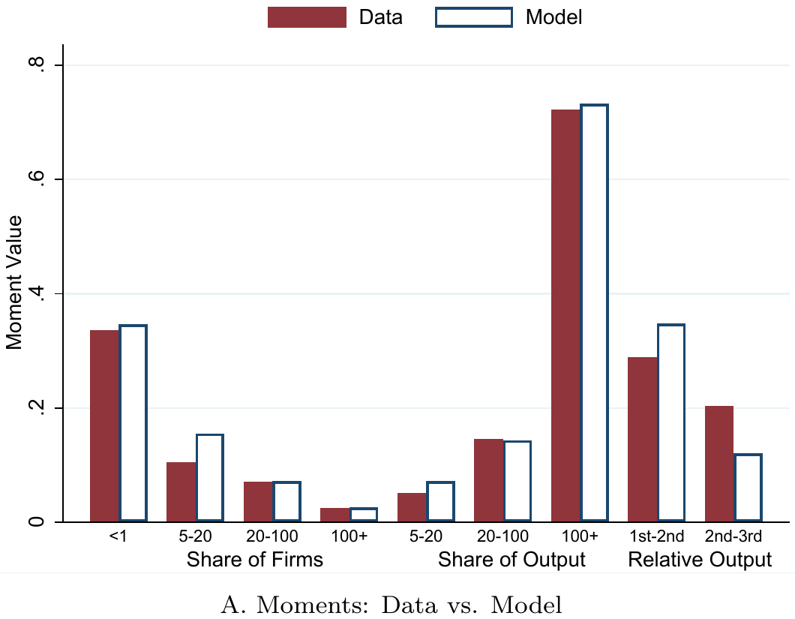

结果解读：每组柱子里，深色是数据矩，空心柱是模型解出来的矩。四组矩上两者几乎重合，说明模型能同时匹配企业规模分布、产出分布与集团内部的产出递减。

**为什么选择这四组矩？**

论文用了 **四组矩**，每组矩对应一个参数的识别：

| 矩 | 内容 | 数据来源 | 识别参数 | 为什么这个矩能识别这个参数 |
|---|---|---|---|---|
| **矩1** | 企业收入在三个区间的份额：5–20百万、20–100百万、>100百万 | ASIF + 2004年经济普查 | $\sigma_m$ | 企业规模分布的形状取决于生产率的离散程度。$\sigma_m$ 越大，企业规模差距越大，分布越分散 |
| **矩2** | 企业产出在同样三个区间的份额 | ASIF + 2004年经济普查 | $\sigma_m$ | 同矩1，从产出侧再次确认规模分布 |
| **矩3** | 集团内第二、三、四大关联企业相对于最大企业的平均产出 | CARD + ASIF | $\delta$ | 集团内产出递减的速度直接取决于 $\delta$。$\delta$ 越小，衰减越快 |
| **矩4** | 收入低于1百万的企业比例 | ASIF + 2004年经济普查 | $\phi_1$ | 生存阈值 $\phi_1$ 决定了多少企业能存活。$\phi_1$ 越高，小企业越少 |

**为什么用两组矩识别 $\sigma_m$ ?** 因为企业规模分布和产出分布都受 $\sigma_m$ 影响，但同时用两组矩可以提供过度识别，增强估计的稳健性。

**为什么用2004年数据？**

这是 **关键的方法论选择**：

- 政策2006年启动，2004年是政策前基准年。
- 用政策前数据估计，模型反映的是 **政策前的经济结构**。
- 然后用这个模型 **预测政策后结果**，与DID对比——这是 **样本外验证**。

**如果用的是政策后数据**，那模型预测政策后结果就是“用答案倒推过程”，没有检验意义。论文用政策前数据估计，然后不重新估计，直接预测政策后结果。预测值与DID估计的95%置信区间高度吻合，说明模型 **正确捕捉了政策的作用机制**。

```stata
* 把 DID 估出来的系数和标准误手写进来，与模型预测并排画图
mat var = (-20.4,  4.2 \    // 表1 Panel B：受监管企业产出
            11.8,  3.7 \    // 表2 Panel A：关联企业产出
             7.3,  1.9 \    // 表3 Panel A：市场溢出
           -36.7,  7.0 \    // 表3 Panel B：集团内部
           -15.6,  4.7 \    // 表1 Panel A：受监管企业能耗
            30.2,  7.6)      // 表2 Panel C：关联企业能耗
gen ci_l = var2 - 2*var3
gen ci_h = var2 + 2*var3
```

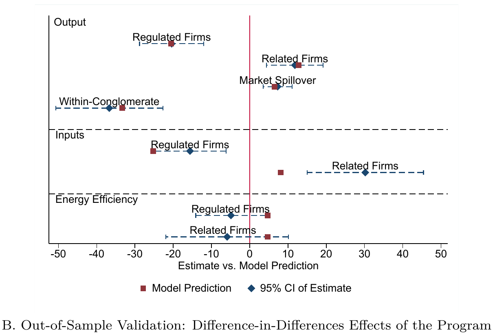

结果解读：横轴是模型预测值，纵轴是DID估计值。产出、投入、能效三组结果里，模型预测都落在DID估计的95%置信区间内。

**估计结果与解读**

| 参数 | 估计值 | 标准误 | 经济含义 |
|---|---|---|---|
| **$\delta$** | 0.90 | (0.003) | 集团内第二家企业效率约为第一家的90% |
| **$\sigma_m$** | 1.24 | (0.055) | 生产率分布的标准差 |
| **$\phi_1$** | 0.61 | (0.166) | 生存阈值 |

```matlab
% 固定参数：文献取值
alpha   = 0.9;            % 规模报酬
alpha_k = 0.1;            % 资本弹性
alpha_l = alpha - alpha_k % 劳动弹性 = 0.8
rho     = 0.75;           % 替代参数，对应 sigma = 4

% 待估参数：没有现成文献值，用2004年数据矩估计
%   param_opt(1) -> 生存阈值
%   param_opt(2) -> 集团内效率衰减 delta
%   param_opt(3) -> 生产率分布标准差 sigma
load param_opt
cutoff = param_opt(1);
delta  = param_opt(2)^(1/(1-alpha));
sigma  = param_opt(3);
```

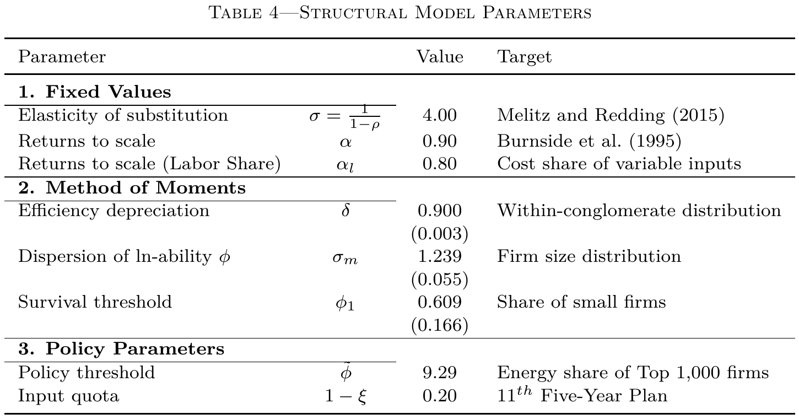

结果解读：上半部分是文献取值的固定参数，中间是矩估计得到的三个参数，下半部分是政策参数。

**$\delta = 0.90$ 意味着什么？**

$\delta = 0.90$，$\alpha = 0.90$，所以集团内产出衰减因子是：

$$
\delta^{\frac{1}{1-\alpha}} = 0.90^{10} = 0.3487
$$

第二家企业的产出约为最大企业的 **35%**。这与Figure 2 Panel A的实证事实（第二家企业约为最大企业的29%）非常接近。

**标准误很小**，说明估计比较精确。$\delta$ 的标准误只有0.003，说明数据对集团内部产出分布的约束很强。

## 六、能效、福利与替代政策比较

### 6.1 两条能效线索的对比

DID里的能效定义：

$$
\text{能效} = \frac{\text{总销售额}}{\text{煤炭使用量}}
$$

- **分子**：总销售额，受价格影响。
- **分母**：煤炭使用量，物理量。

**DID结果**：

| 变量 | 变化 |
|---|---|
| 能耗 | 下降约12.8% |
| 产出（销售额） | 下降约14.5% |
| 能效 | 下降约1.9%，**不显著**（p=0.691） |

**关键**：销售额 **下降** 了14.5%，不是上涨。虽然被监管企业减产导致价格上升，但价格上升幅度 **不足以抵消数量下降幅度**，所以销售额整体还是下降的。

能效变化 ≈ 产出变化 − 能耗变化 = −14.5% − (−12.8%) = −1.7%，统计上不显著。

**结构模型的能效：分子是产出数量**

结构模型里的能效定义：

$$
\text{能效} = \frac{\text{产出数量}}{\text{能耗}}
$$

- **分子**：产出数量（物理量），不受价格影响。
- **分母**：能耗。

**核心企业**：被约束能耗，能耗大幅下降。但资本固定，产出下降幅度小于能耗下降幅度，所以核心企业能效 **上升**。

**关联企业**：承接生产，产出上升约12%，能耗上升约30%。能耗上升幅度大于产出上升幅度，所以关联企业能效 **下降**。

**集团整体**：核心企业能效上升，关联企业能效下降，两者加权平均，**整体能效变化不显著**。

**两条线索的对比**

| | DID | 结构模型 |
|---|---|---|
| **能效分子** | 总销售额（受价格影响） | 产出数量（物理量） |
| **能效分母** | 煤炭使用量 | 能耗 |
| **被监管企业** | 销售额↓14.5%，能耗↓12.8%，能效≈不变 | 产出↓少，能耗↓多，能效↑ |
| **关联企业** | 产出↑12%，能耗↑30%，能效≈不变 | 产出↑少，能耗↑多，能效↓ |
| **整体** | 能效不显著 | 能效不显著 |

**两条线索的结论一致：能效没有显著提升。但背后的机制不同。**

```matlab
%%% Table 5：把 DID 估计按模型拆成三块
%%% 第一列配置效应，第二列剩余收入效应，第三列市场效应，第四列合计
decomposition_results = [ ...
  share_regulated       , residual_rev_regulated                        , market_demand_all , ... ;   % 被监管企业
  0                     , residual_rev_control                          , market_demand_all , ... ;   % 控制组
  share_regulated       , residual_rev_regulated-residual_rev_control   , 0                 , ... ;   % DID
  share_related         , residual_rev_related                          , market_demand_all , ... ;   % 关联企业
  share_regulated-share_related , 0 , 0 , share_regulated-share_related ] ;                          % 集团内部
```

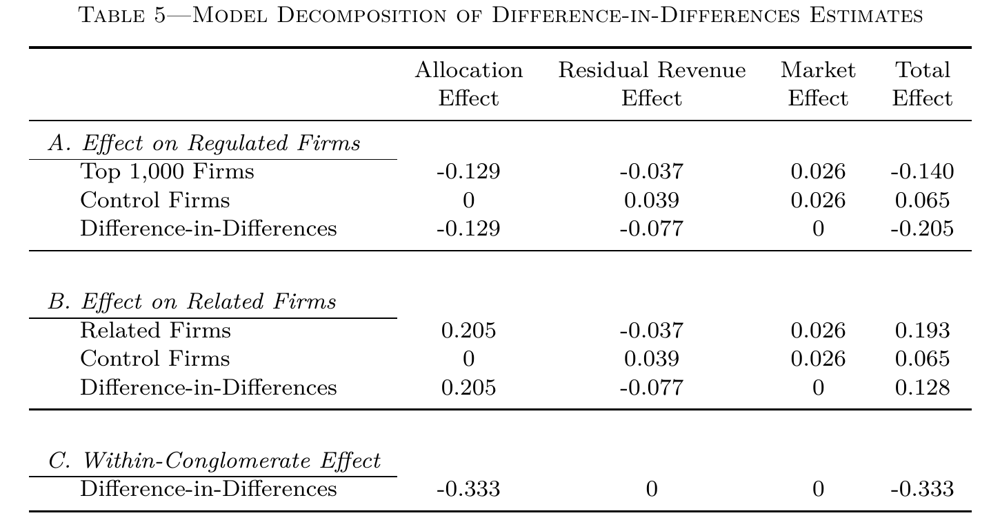

结果解读：DID估计被拆成配置效应、剩余收入效应和市场效应。被监管企业的下降与关联企业的上升都主要来自配置效应。

### 6.2 福利函数与盈亏平衡点

$$
W = \left(\frac{R}{P}\right)^{1-\kappa} \left(\frac{1}{\beta_0 E}\right)^{\kappa_0} \left(\frac{1}{\beta_1 E}\right)^{\kappa_1}
$$

这个福利函数由 **三部分** 组成：

| 项 | 含义 | 来源 |
|---|---|---|
| $(R/P)^{1-\kappa}$ | 消费带来的正效用 | CES偏好下的间接效用 |
| $(1/(\beta_0 E))^{\kappa_0}$ | 碳排放带来的负效用 | 全球外部性 |
| $(1/(\beta_1 E))^{\kappa_1}$ | 本地污染带来的负效用 | 本地健康损害 |

**消费效用 $(R/P)$**：在CES偏好下，消费者在预算约束下最大化效用，间接效用等于$R/P$，即实际收入。

**碳排放负效用**：能源使用$E$产生碳排放$\beta_0 E$，导致全球变暖，是负外部性。写成$1/(\beta_0 E)$表示碳排放越多，福利越低。

**本地污染负效用**：能源使用也产生本地污染$\beta_1 E$，导致健康损害。写成$1/(\beta_1 E)$表示污染越多，福利越低。

**为什么用柯布-道格拉斯形式？** 三项乘在一起，指数之和$(1-\kappa) + \kappa_0 + \kappa_1 = 1$，保证规模报酬不变。$\kappa$越大，政府越关心环境。

**福利变化公式**

对福利函数取对数并标准化后：

$$
\frac{d\ln W}{1-\kappa} = -\ln\left(\frac{P}{P^*}\right) - \frac{\kappa}{1-\kappa}\ln\left(\frac{E}{E^*}\right)
$$

- $\kappa = \kappa_0 + \kappa_1$：政府对社会成本（碳）和本地污染的健康成本的综合权重。
- 第一项：价格上升的福利损失。
- 第二项：能耗下降的福利收益。

**求盈亏平衡点**

令d ln W = 0：

$$
0.0344 = \frac{\kappa}{1-\kappa} \times 0.0408
$$

$$
\frac{\kappa}{1-\kappa} = 0.843
$$

$$
\kappa = 0.457
$$

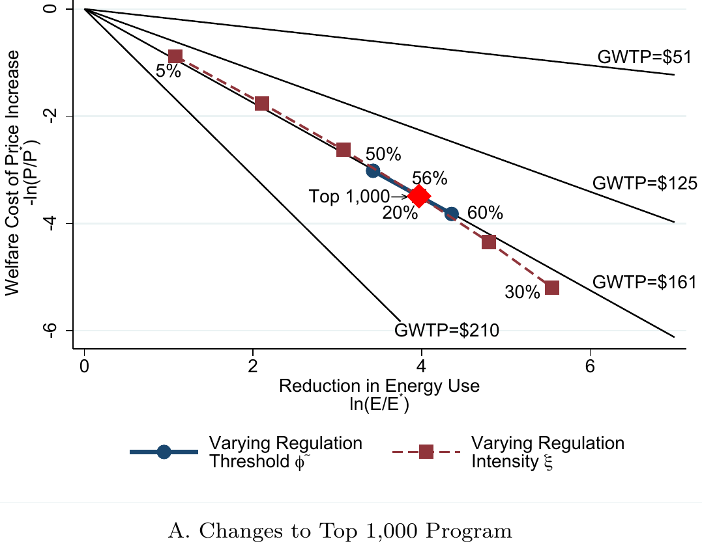

结果解读：横轴是节能幅度，纵轴是福利成本。同一个 kappa 下福利成本是一条直线，斜率由 $\kappa/(1-\kappa)$ 决定；四条直线对应四个不同的 GWTP 门槛。红点是被监管企业所处的政策位置。

### 6.3 换算成GWTP

$$
\kappa = \frac{\text{GWTP} \times \text{碳排放}}{\text{GDP} \times 0.8}
$$

**这个公式的来源**：$\kappa$是福利函数中环境的总权重。为了给它一个经济学含义，作者将其与政府愿意为每吨碳减排支付的金额（GWTP）挂钩。如果政府愿意支付GWTP来换取一吨的碳减排，那么这笔支付相当于全国总收入（GDP）的一部分，这个比例就是$\kappa$。

**0.8的来源**：这是作者考虑到中国“十一五”规划中，政府承认其节能目标存在“未充分支出”而设定的调整因子，旨在使理论模型更贴合中国实际政策背景。

代入：

- 2006年中国碳排放 = 63.8亿吨
- 2006年中国GDP = 2.752万亿美元
- 0.8 = 十一五规划承认的节能目标调整因子

$$
\text{GWTP} = \frac{0.457 \times 2.752 \times 0.8}{6.38} = 161 \text{ 美元/吨}
$$

考虑各种不确定性后，合理范围是 **114—199美元/吨碳**。

**这个范围如何得来？** 论文通过敏感性分析，检验模型在不同假设下的结果：

| GWTP估计值 | 对应场景 | 核心变化与逻辑 |
|---|---|---|
| **$114** | 企业能低成本提升能效 | 假设企业能以较低成本投资节能技术。政策执行更轻松，代价更小，政府愿意支付的意愿下限也 **更低** |
| **$161** | 基准模型 | 论文的核心估计值 |
| **$199** | 企业能效存在巨大差异 | 假设被监管企业能效比关联企业低20%。政策迫使生产从“脏”的核心企业转移到“相对干净”的关联企业，产生额外环境收益，政府愿意支付的意愿上限也 **更高** |

这个范围表明，无论模型参数如何调整，$161的基准结论都相对稳健。

**背后参考的权威文献**：

- **碳的社会成本（SCC）**：Mohan et al. (2020)
- **污染的健康成本**：World Bank (2007)
- **支付意愿（WTP）**：Ito and Zhang (2020)

### 6.4 模型的核心结论与替代政策

| 政策 | 能耗下降 | GWTP门槛 | 关键含义 |
|---|---|---|---|
| 千家企业（现状） | 3.97% | 161美元 | 基准 |
| **监管整个集团** | **4.36%** | **154美元** | 同等福利成本下 **多节能10%** |
| 规模依赖型能源税 | — | 154美元 | 效果与集团监管接近 |
| **统一能源税** | — | **153美元** | 效果最好 |

```stata
* 把模型反事实的百分比结果换成"福利成本"与"节能幅度"
foreach var in v4 v5 v6 v7 v8 v9 {
    replace `var' = -ln(`var')*100
}
* 盈亏平衡的 kappa，再折成每吨碳的支付意愿
local kb = -v4[10]/v5[10]
local kb = `kb'/(1+`kb')
local gwtp = round(`kb'/(6.38/(2.752*1000)*1.25), 1)
di `gwtp'        // 161 美元/吨
```

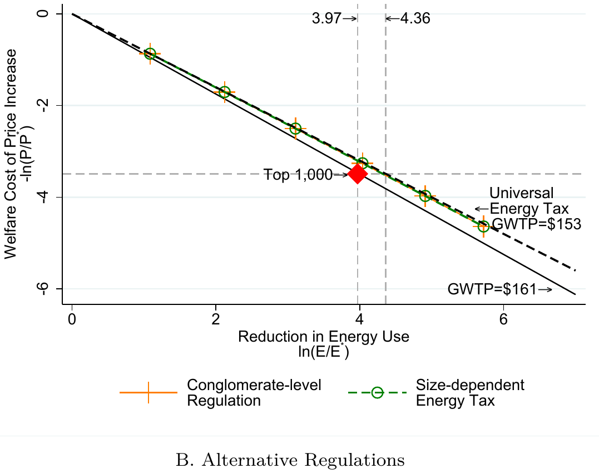

结果解读：横轴是节能幅度，纵轴是福利成本。监管整个集团在同等福利成本下节能更多，效果接近规模依赖型的能源税；统一能源税效果最好。

**为什么监管集团更有效？**

- 套利空间被堵住：企业集团的经济决策单位是集团，监管单位是单个企业。两者不一致时，资源就会流向监管边界之外。
- 信息其实是公开的：CARD工商注册数据是公开可得的，监管者不需要新建信息系统。

**监管的边界，必须与企业的决策边界对齐。**

**模型的核心结论**

- 影子成本 $\lambda$ 平均约 **8.7%**，相当于对投入品征收 **8.7%的隐性税**。
- 如果关掉市场溢出和集团溢出，影子成本会升到 **15.6%**。
- 集团内部转移使影子成本 **降低了约30%**——企业确实在规避约束。
- 全国净节能 **约4%**，每年约 **4,800万吨标准煤**，远低于政策预期的 **1亿吨**。
- 价格水平上升约 **3.5%**。
- 政策划算的前提：GWTP ≥ **161美元/吨碳**。

## 七、论文的贡献与政策启示

### 7.1 企业集团是节能政策的重要漏洞

- 不考虑集团内部转移，会系统性高估政策效果。
- 监管必须从“单个企业”转向“整个集团”。
- **监管的边界，必须与企业的决策边界对齐。**

**利用公开信息设计政策**

- 工商注册数据是公开的，可以用来识别企业网络。
- 这比“简单扩大名单”要根本得多——扩大名单还是一家一家地管，集团内部的套利空间原封不动。

### 7.2 政策工具组合：碳市场、碳税与行政管制的互补逻辑

- 中国目前没有全国性碳税，但有碳市场。
- 未来可能形成“**碳市场+碳税+行政管制**”的组合。
- 行政性总量控制容易产生溢出，需要配合市场机制和集团监管。

### 7.3 论文的贡献

1. **首次系统研究企业集团在节能政策中的角色**：把股权网络引入政策评估。
2. **DID与结构模型结合**：既给出可信的因果事实，又能量化两种溢出。
3. **重新评估千家企业节能行动**：官方口径下的成功，在全国层面打了约四折。
4. **提出改进政策设计的方向**：监管集团、利用公开的网络信息。

## 八、编者按：从能耗双控到碳排放双控——历史会重演吗？

读完这篇论文，我最深的感受是：**政策的初衷和政策的执行之间，往往隔着一道“监测能力”的鸿沟。**

“千家企业节能行动”的初衷是好的——考核能效，推动企业通过技术改造来节能。但地方政府很快发现，能效根本没法准确测量：一家钢铁厂有几百种产品、几十道工序，每种产品的能耗标准不同，企业还能在五套计算公式里择优、逐年更换。于是地方政府退而求其次，选择了更易执行的“能耗总量配额”。结果是：企业不再提效，而是减产和转移生产。

这个逻辑链条，在碳排放领域正在以几乎相同的剧本重新上演。

### 8.1 碳排放的“监测难题”比能耗更大

能耗双控至少还有一个相对成熟的统计体系——企业买多少煤、用多少电，这些数据可以追踪。但碳排放的核算要复杂得多。

碳排放 = 能源消费量 × 碳排放因子。能源消费量可以监测，但碳排放因子怎么确定？煤炭的碳排放因子取决于煤种、产地、燃烧效率；电力的碳排放因子取决于电网结构，而电网结构每时每刻都在变化。更要命的是，工业生产过程本身还会产生碳排放——比如水泥生产中的碳酸钙分解，这部分“过程排放”和能源消费完全无关，但它在水泥行业碳排放中占比超过50%。

目前，我国碳排放统计核算体系尚不完善，各层级碳排放底数不清、方法不明确、工业生产过程基础统计体系不健全、统计核算时效性滞后、碳排放因子本地化水平不高。地方核算较多依赖宏观推算，中小企业尚未建立系统监测制度，易给碳市场配额分配和减排绩效评估带来偏差风险。

简言之：**能耗数据的颗粒度是“企业级”，碳数据的颗粒度可能只是“区域级”或“行业级”。** 如果连企业层面的碳排放都算不准，地方政府怎么可能去考核单个企业的碳强度？

### 8.2 碳排放双控会不会同样“从强度滑向总量”？

“十五五”规划明确提出全面实施碳排放总量和强度双控制度，2026年起对各省党委和政府进行综合评价考核。从制度设计上看，碳排放双控从一开始就同时包含了总量和强度两个维度——这本身是对能耗双控“从强度滑向总量”教训的一种修正。

但这里有一个关键的区别：**能耗双控的总量指标是“能源消费总量”，碳双控的总量指标是“碳排放总量”。** 前者可以用“吨标准煤”来统一衡量，后者则需要把不同温室气体、不同来源的排放折算成“吨二氧化碳当量”。

折算本身就意味着误差，而误差在地方政府执行时会被放大。如果碳核算的误差大到无法判断某家企业是否“达标”，地方政府就可能再次采取最简单粗暴的办法——**“不管你到底排了多少，我给你一个配额，超了就限产”。**

这就是论文所揭示的溢出效应的“碳版本”：企业发现，与其花钱去做碳捕集、换清洁能源、改造工艺，不如把高碳生产环节转移到没有碳配额约束的关联企业或地区去。如果监管单位是单个企业，而企业决策单位是整个集团，同样的套利逻辑就会在碳领域重演。

### 8.3 碳税与碳市场：两种逻辑，一个目标

论文中比较了“监管单个企业”和“统一能源税”的效果，发现能源税在同等福利成本下效果更好。这引出一个问题：碳税和碳市场，在应对“碳监管溢出”上，逻辑有什么不同？

从政策工具的本质来看，碳税是政府定价手段，碳价确定而减排效果不确定；碳交易是市场定价手段，减排效果确定而碳价不确定。

目前中国选择了碳市场而非碳税。截至2026年8月，全国碳排放权交易市场累计成交量9.61亿吨、成交额656.99亿元，覆盖发电、钢铁、水泥、铝冶炼四个行业共3680家重点排放单位，覆盖二氧化碳排放量约83亿吨，占全国碳排放总量65%以上。

碳市场的优势在于：**配额是总量控制的，减排效果确定。** 如果一个企业把生产转移到关联企业，只要关联企业也在碳市场覆盖范围内，它就同样需要持有配额——总量控制不会被“转移生产”轻易规避。但碳市场的短板也很明显：**它依赖于准确的碳排放数据。** 配额分配需要知道每家企业的历史排放和当前排放，MRV体系需要核验企业的实际排放量。如果数据不准，配额分配就会失准，碳市场的资源配置功能就会扭曲。

碳税的逻辑不同。碳税不依赖于企业层面的精确排放数据，它只需要知道 **能源产品的碳含量**。煤的碳含量高，就多收税；天然气的碳含量低，就少收税。企业买多少煤、交多少税，这一点和能耗总量控制一样容易执行。碳税不需要测量每家企业的实际排放，它通过 **价格信号** 来引导企业减少化石能源消费。

论文中“统一能源税”效果更好的逻辑，在碳领域同样适用：**如果碳税覆盖所有化石能源，企业无论怎么转移生产，只要还在用化石能源，就逃不掉税收。** 碳税堵住的是“监管边界”的漏洞，而不是“企业边界”的漏洞。

但碳税的问题也很明显：**它提高生产成本，可能影响出口竞争力**。而且碳税是“价格确定、减排效果不确定”——政府无法精确控制最终减了多少碳。在当前“双碳”目标需要精确考核的背景下，碳税的政治可行性远低于碳市场。

### 8.4 一个更深层的追问：企业会重演“转移生产”吗？

如果碳排放双控真的全面落地，企业是否也会像当年应对能耗配额那样，把高碳生产转移到集团内外的关联企业？

答案是：**取决于碳监管的边界是否与企业决策的边界对齐。**

论文已经给出了答案：监管单个企业，溢出40%；监管整个集团，溢出被堵住，还能多节能10%。这个逻辑在碳领域完全适用——如果碳配额只发给单个法人企业，集团就可以把高碳生产环节转移到不持有配额或配额宽松的关联企业。但如果碳配额按集团合并核算，集团内部怎么转移都是“左手换右手”，总配额不变。

更棘手的是 **地理转移**。论文发现，当年“千家企业节能行动”没有导致显著的地理再配置，因为能耗配额是地方政府的考核指标，地方政府有动力确保辖区内所有被监管企业都达标。但碳监管的地理边界更复杂——如果一个省碳配额紧张，另一个省宽松，企业是否会把高碳产能从紧张省份转移到宽松省份？目前“上下结合、因地制宜”的目标分解方式赋予了地方灵活性，但也可能为跨省套利留下空间。

这不仅是中国的难题。欧盟碳边境调节机制（CBAM）在2026年正式进入征收期，覆盖钢铁、铝、水泥、化肥、氢和电力六大行业，核心目的就是堵住“碳泄漏”——防止欧盟企业把高碳生产转移到碳监管宽松的国家。CBAM的逻辑本质上是：**你可以在你的国家低成本生产，但你把产品卖到我的市场时，必须支付和我本地企业同等的碳成本。**

这意味着，碳监管的“溢出”不仅发生在企业集团内部和国内市场，还发生在国际层面。如果中国的碳价长期低于欧盟，出口企业将面临越来越高的CBAM成本；如果中国的碳价接轨欧盟，国内高碳企业的成本压力又会剧增。这是一个两难。

### 8.5 历史的教训与结语

回到论文的核心教训。能耗双控之所以从“强度”滑向“总量”，根本原因是 **地方政府无法测量能效**。碳排放双控面临同样的问题：如果碳排放的MRV体系不够完善，地方政府就可能再次选择“不管你怎么排，我给你一个配额，超了就限产”的执行方式。

而一旦执行变成“总量配额”，企业就会再次选择“减产和转移”，而不是“真正的低碳转型”——就像当年选择“减产”而不是“提效”一样。

但这不意味着我们注定重蹈覆辙。论文给了我们一个明确的政策方向：**监管的边界必须与企业的决策边界对齐。** 如果碳监管从一开始就按集团合并核算碳排放总量，企业内部的转移生产就无法规避监管。如果碳税覆盖所有化石能源消费，无论生产在哪个企业、哪个地区，都无法逃税。

碳市场、碳税、行政管制，这三者不是互斥的，而是互补的。碳市场提供总量控制的确定性和市场化的资源配置；碳税提供价格信号的普适性和执行上的简便性；行政管制提供刚性约束和政治执行力。论文中“统一能源税”效果最好的结论，并不意味着中国应该放弃碳市场，而是提醒我们：**在碳监管的执行层面，越是依赖精确数据的手段，越容易在数据能力不足时退化；越是依赖价格信号的手段，越不容易被“转移生产”规避。**

**结语**

“千家企业节能行动”的故事告诉我们：一项好的政策，如果执行方式被迫偏离初衷，结果可能事与愿违。企业不会对抗政策，它们会绕过政策——通过减产、转移生产、调整产品结构，把监管的负担从被监管的边界之内，转移到边界之外。

碳排放双控正在路上。碳市场的覆盖范围在扩大，碳税的研究储备在推进，CBAM在倒逼出口企业建立碳足迹管理体系。但监测能力是否跟得上监管目标？企业的套利空间是否被真正堵住？监管边界是否与决策边界对齐？

这些问题的答案，将决定我们是否会在碳领域重演“强度滑向总量、提效滑向减产”的历史。而论文给出的最深刻的启示或许是：**不要指望企业会“自觉”地选择更贵的技术路径。政策的执行力，永远取决于监管边界与决策边界的重合程度。**

## 九、结语

**千家企业节能行动让被监管企业减产降耗，但企业通过把生产转移到集团内外的关联企业，导致实际总节能效果打了很大折扣。模型的核心是影子成本 $\lambda$：它由二次方程解出，只依赖于集团规模 $n$，不依赖于 $\phi$。$\lambda$ 越大，集团越想把生产挪到关联企业。算出来的 $\lambda$ 平均约8.7%。然后模型用 $\lambda$ 算产出楔子 $\xi_q$ 和能耗楔子 $\xi_e$，代入价格方程和能耗方程，得到全国净节能4%和GWTP=161美元/吨。更好的做法是监管整个集团，这样同等福利成本下能多节能10%。监管的边界，必须与企业的决策边界对齐。而这一教训对正在推进的碳排放双控同样适用——如果碳监管的边界不与企业的决策边界对齐，如果碳数据的监测能力跟不上监管目标，我们可能会在碳领域重演“强度滑向总量、提效滑向减产”的历史。**

（文章结束，我们下期再见！）

> 🍓如有疑问或建议，欢迎在评论区或者后台留言交流。
>
> 🍓感谢阅读，祝研究顺利。
